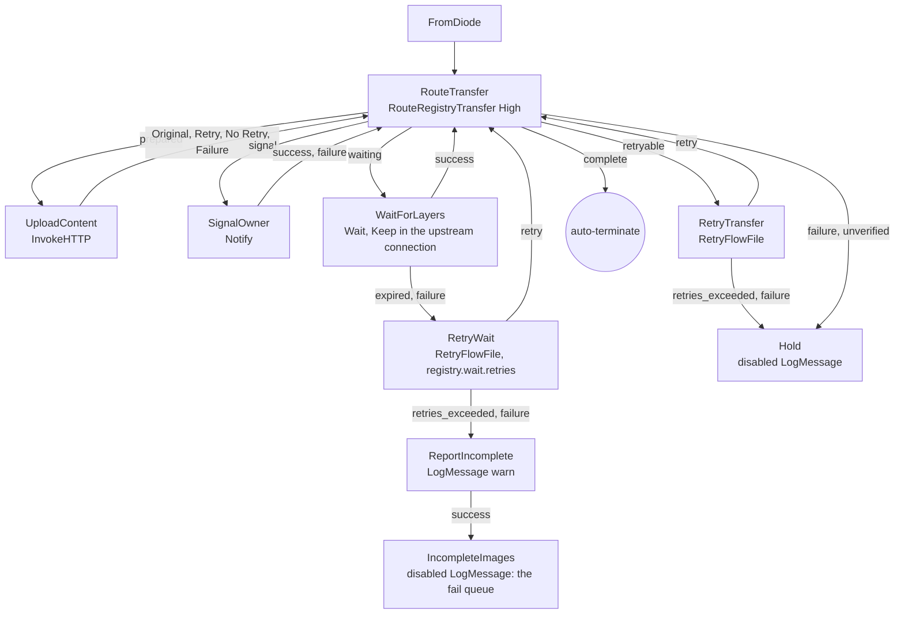

# Hold manifests with Notify and Wait

## Context

The diode delivers blobs and manifests in random order. Up to 1.6.0 the high side held a manifest whose layers had not all arrived in a RetryFlowFile loop. RouteRegistryTransfer asked the registry again on a doubling interval (30 s up to 30 min) and, after Stale After Hours, sent the manifest to `stale`. Nothing told a waiting manifest that a layer had just arrived, so a manifest could sit up to 30 minutes after its last layer. The loop held no count of what had arrived, only a message on the last check.

The owner asked for a Notify/Wait design: a signal counter per manifest, Wait expiration that routes to a retry, a bounded retry count, then a fail queue for layers that never arrive, with the wait queue protected from overflow and transparency attributes on the waiting manifest.

## Decision

1.7.0 holds manifests at a native Wait, released by a native Notify per arrived dependency. The registry stays the authority: Wait only decides when RouteRegistryTransfer looks again.

### Flow

### Signals

PlanRegistryTransfer writes `owners` into every job: the digests of the manifests (for a blob or config) or the index (for a platform manifest) that need it. A blob shared by two platforms has two owners and still crosses once. The low side carries the list as `registry.owners`.

On the high side, when a blob, config or manifest is in the registry (uploaded, or already present), RouteRegistryTransfer sends it to `signal` once per owner with `registry.signal.id` set to that owner's digest. Notify adds 1 to counter `received` of that signal. Success and failure both return to RouteRegistryTransfer, which signals the next owner or finishes with `complete`. A lost signal costs time, not data: the expiry recheck below finds the dependency in the registry.

### Waiting

On arrival, and on every return from Wait or RetryWait, RouteRegistryTransfer HEADs every dependency in the registry. All present: the manifest is uploaded. Some missing: it goes to `waiting` with the transparency attributes, and Wait holds it with:

| Wait property | Value | Why |
|---|---|---|
| Release Signal Identifier | `${registry.digest}` | One signal per manifest, keyed by its own digest, which is also its digest in the destination |
| Signal Counter Name | `received` | The counter Notify adds to |
| Target Signal Count | `${registry.wait.expected}` | Every dependency of the manifest. Each job of a transfer signals once, so the count reaches it when the last one is in |
| Releasable FlowFile Count | `1` | A release takes the target off the counter, so leftover signals cannot release the same manifest again and again |
| Expiration Duration | `10 min` | How often a waiting manifest is checked against the registry anyway, and how often its attributes refresh |
| Wait Mode | Keep in the upstream connection | The `waiting` queue is the only buffer: no `wait` self-loop queue to grow |
| Wait Penalty Duration | `30 sec` | One identifier with no signal does not hold up the others |

A release is a hint. RouteRegistryTransfer checks the registry again and sends the manifest back to Wait if a dependency is still missing, for example when a signal counted for an earlier transfer of the same digest.

RouteRegistryTransfer sets `wait.start.timestamp` to the current time on every `waiting`, so each Wait visit gets a full Expiration Duration. It cannot remove the attribute, and Wait routes an empty value to `failure` (seen on the first live run).

### Bounded retry and the fail queue

Wait `expired` and `failure` (cache unreachable) go to RetryWait, a RetryFlowFile with its own Retry Attribute `registry.wait.retries`, separate from the error retries in `registry.retries`. RouteRegistryTransfer never resets it while the manifest waits, and blanks it when the manifest leaves the wait. Maximum Retries `144` times Expiration Duration `10 min` is 24 hours, the old Stale After Hours default. After that, `retries_exceeded` goes to ReportIncomplete, which logs `registry.error` as a WARN bulletin (the image, platform, missing layer numbers and the check code an operator quotes for a resend), and then to IncompleteImages. IncompleteImages is a disabled LogMessage, so its queue is the fail queue. Enable it to discard what is queued.

### Transparency attributes

Written on every check of a manifest or index:

| Attribute | Value |
|---|---|
| `registry.wait.received` | Dependencies in the registry at the last check (X) |
| `registry.wait.expected` | All dependencies (Y): the config and layers of a manifest, or the platform manifests of an index |
| `registry.wait.missing` | The digests still awaited, comma separated. Empty once all are in |
| `registry.manifest.digest` | The digest the manifest is published under. The transfer keeps the source bytes, so it is the source digest and the destination digest |
| `registry.error` | The human-readable line: `<image> (<platform>) incomplete: missing layers 2,3 of 5. Check code <8 hex>` |

Wait also copies counter `received` to `wait.counter.received` when it releases a manifest.

### Back pressure

| Connection | Objects | Size | Why |
|---|---|---|---|
| RouteTransfer `waiting` to WaitForLayers | 10000 | 1 GB | In the loop. Manifests are a few KB, so 10000 is far more images than are in flight; a smaller limit can stop RouteTransfer and with it the blobs the manifests wait for |
| RouteTransfer `signal` to SignalOwner, SignalOwner to RouteTransfer | 10000 | 20 GB | In the loop and carries blobs |
| WaitForLayers to RouteTransfer, WaitForLayers to RetryWait, RetryWait `retry` to RouteTransfer | 10000 | 1 GB | In the loop: NiFi's default |
| RetryWait to ReportIncomplete, ReportIncomplete to IncompleteImages | 10000 | 1 GB | Out of the loop. Full means 10000 images never completed, which stops the wait loop on purpose |

A waiting manifest leaves the `waiting` queue at expiry, through RetryWait, and leaves the loop for good after 144 tries. No connection uses FlowFile Expiration, which would drop data without a trace.

### Cache

Wait and Notify need an AtomicDistributedMapCacheClient that every node reaches, so a signal from one node releases a manifest on another. The estate uses RedisDistributedMapCacheClientService (TTL 7 days) as in diode-high. A MapCacheClientService pointed at `localhost` gives each node its own cache: signals from other nodes are then lost and manifests wait for the expiry recheck.

## Consequences

Breaking for a 1.6.0 high side, so the release is 1.7.0. RouteRegistryTransfer loses the `Stale After Hours` property and the `stale` relationship, gains the `signal` relationship, and no longer waits on a timer of its own. `registry.wait.since`, `registry.wait.checks` and `registry.wait.next` are gone. Upgrade a high side by adding SignalOwner, WaitForLayers, RetryWait, ReportIncomplete and IncompleteImages and the connections above, and by moving the `waiting` connection from RetryTransfer to WaitForLayers.

A 1.6.0 low side sends no `registry.owners`. The high side then signals nobody and every waiting manifest proceeds at its next expiry recheck, at most 10 minutes after its last layer.

Two cards and one cache service more than 1.6.0. A manifest proceeds within one Wait run of its last dependency instead of up to 30 minutes.

Signals left in the cache for a manifest that never waited expire with the cache TTL. Before then they can release a later wait of the same digest early, which costs one registry check.

## Live proof (nifi-dev, 2026-10-30)

Sandbox PG "research notify-wait e2e 2026-10-30" on nifi-dev, built from the two flow specs with Wait Expiration Duration `3 min` and RetryWait Maximum Retries `2` to keep the run short. Source Harbor docker-hub proxy `library/nginx:1.26-alpine`, Platform Selection `linux/amd64,linux/arm64`, destination quay.cbr `research/native-high`, Redis signal cache of diode-high. A RouteOnAttribute between the two sides stood in for a lossy diode: it never delivered amd64 layer 2 (`sha256:914d0eaf...`) and held arm64 layer 8 (`sha256:1ee6408a...`) until released by hand.

| Case | Result |
|---|---|
| Layer arrives late | Released 03:08:18. The arm64 manifest was in Quay at 03:08:44, before its first Wait expiry: the Notify signal released it |
| Layer never arrives | The amd64 manifest left the wait loop after three expiries. ReportIncomplete at 03:17:43: `nginx:1.26-alpine (linux/amd64) incomplete: missing layers 2 of 8. Check code 1eadbb07; received 8 of 9, awaiting sha256:914d0eaf...`. It waits in the IncompleteImages queue; Quay has no amd64 manifest |
| Duplicate delivery | A first run planned the image three times (Run Once on three nodes). Every copy completed or reached the fail queue; nothing looped |

The first run also showed that Wait sends a FlowFile with a blank `wait.start.timestamp` to `failure`; RouteRegistryTransfer now sets it to the current time.
