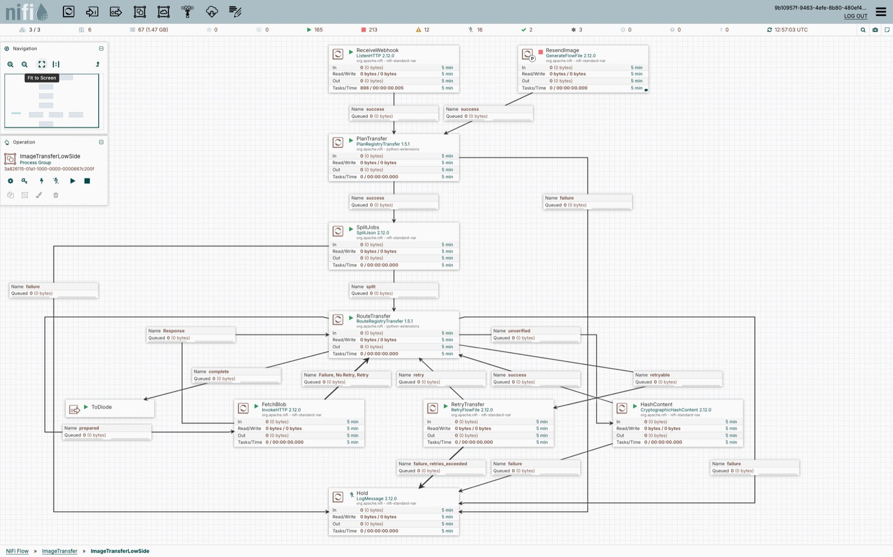
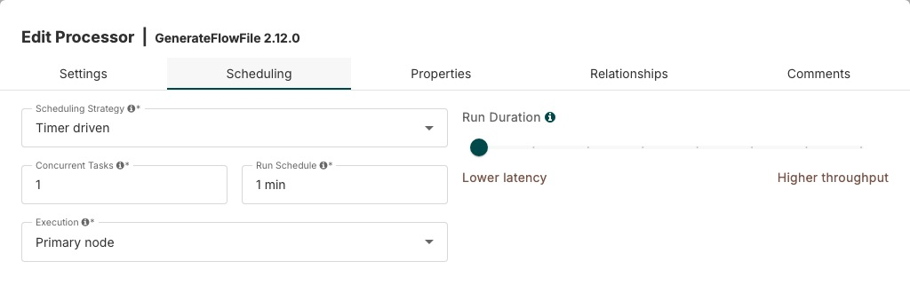
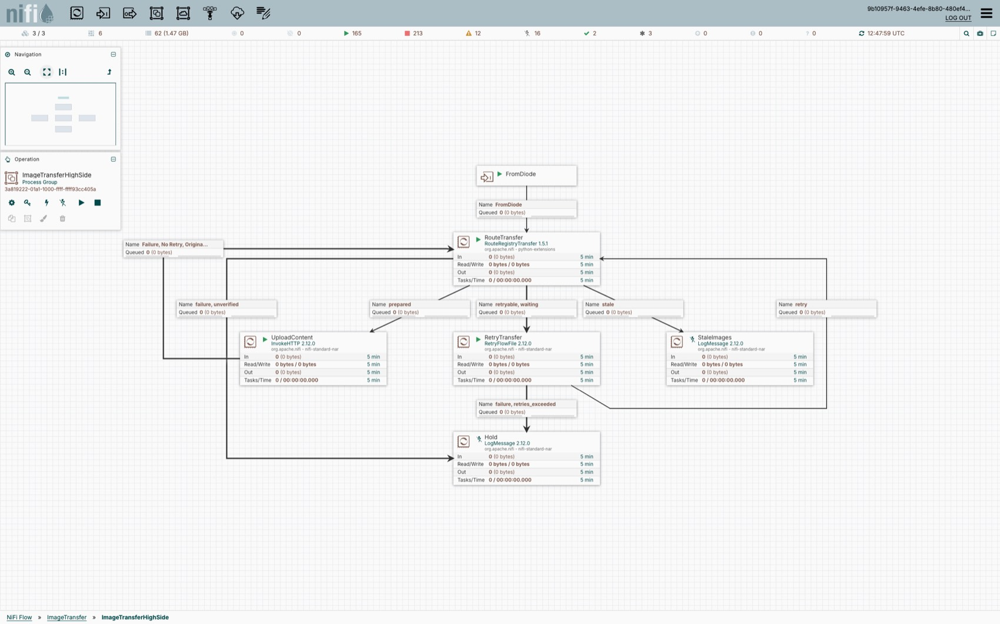

# Build the image transfer by hand

The image transfer moves a container image across a data diode one layer at a time. The low side reads the source registry and sends one FlowFile per blob and per manifest. The high side checks that every layer a manifest needs has arrived, uploads the blobs, then commits the manifest by digest and by tag. This guide is for **NiFi 2.12.0** with **PlanRegistryTransfer / RouteRegistryTransfer 1.5.3**.

The two sides are built on different NiFi instances at work, so the guide is split the same way:

- [Common setup](#common-setup): install the Python processors, once per NiFi instance.
- [Low side](#low-side): the source-side flow, 8 processors, 1 optional recovery card and the `ToDiode` port.
- [High side](#high-side): the destination-side flow, 4 processors and the `FromDiode` port.

Each side lists only what you change from NiFi's defaults. What each processor requires of its input, and the exact error text it sets when the input is wrong, is in the [input contract](../reference/contract.md). A property, setting or queue option that is not listed stays at the value NiFi gives it. Names are exactly as the NiFi UI shows them. Values were read from the live production flow on 2026-10-15, except registry addresses, credentials and CA paths, which are examples.

`#{name}` is a **Parameter Context** reference. `${name}` is **FlowFile Expression Language**. Copy both forms exactly. Property names and relationship names are case-sensitive.

## Common setup

### Install the Python processors on every node

You need Python 3.10 or later, NiFi's standard processor NARs, access to each registry's HTTPS endpoint, and enough content and provenance disk for active transfers and retention. Neither Docker nor skopeo is required on the NiFi nodes. Copy the **whole** `python/container-registry` directory, including its helper modules; copying just the two processor files is insufficient.

For the validated source revision:

```sh
git clone https://github.com/djlongy/nifi-container-registry-processors.git
cd nifi-container-registry-processors
git checkout 559c53aa6e7bac04f53c83239dc3b184531caad7
cp -R python/container-registry /opt/nifi/nifi-current/python_extensions/
```

Run the copy as the NiFi service account, or set ownership so that account can read the files and write its Python working directory. Adjust the destination to `nifi.python.extensions.source.directory.default` in `nifi.properties`. Set `nifi.python.command` to your Python executable if Python is not enabled. Changing NiFi startup properties requires a restart; copying extension files is discovered by the loader. On a cluster install the same files on **every node**, then wait until the processor types at **1.5.3** appear in **Add Processor** and validate across the cluster. Do not change an existing Python processor's bundle version by API; create it at the installed version.

For containers, persist the modules through an image or init container or a mounted source directory. A manual copy is lost if your init container replaces that directory at restart. Do not install the older Java/NAR implementation for this flow.

The low side needs **PlanRegistryTransfer** and **RouteRegistryTransfer**. The high side needs **RouteRegistryTransfer** only. If both sides are on one NiFi instance (a test), the install is done once.

## Low side

The low side reads the source registry. It is built on the low NiFi instance, inside a process group named `ImageTransferLowSide`.

How it works: a webhook (or the optional `GenerateFlowFile` card) delivers a small JSON request. `PlanRegistryTransfer` resolves the image into jobs, `SplitJson` makes one FlowFile per job, and `RouteRegistryTransfer` prepares each registry request. `InvokeHTTP` downloads the bytes, `CryptographicHashContent` checks them, and `RouteRegistryTransfer` releases the verified FlowFile to `ToDiode`.

### Low screenshot

Actual screenshot of the running, empty-queue `ImageTransferLowSide` canvas on 2026-10-15. Click it to open it at full size. Connection labels show the selected relationships. The cards carry the suggested names, so the screenshot shows the renamed canvas (see [L12](#l12-rename-the-cards-optional)). Statistics in the top toolbar describe the whole NiFi cluster, not only the image transfer.

[](../images/image-transfer-low-side.jpg)

### L1. Create the group, parameters and optional trust

On the low NiFi instance, create a **Process Group** named `ImageTransferLowSide` and build everything below inside it. Open **Global menu, Parameter Contexts, +** and create a context holding only the source-side parameters. Bind it with **ImageTransferLowSide, Configure, Parameter Context**. Do not put destination credentials here.

| Parameter | Sensitive | Example value / purpose |
|---|---|---|
| `gitlab.container.low.url` | No | `https://quay-low.example.internal` |
| `gitlab.container.low.username` | No | `team+mirror_read` robot with pull access |
| `gitlab.container.low.token` | **Yes** | Your source robot token. Enter it in the sensitive parameter, never as a literal processor property |
| `gitlab.container.low.allowed.repositories` | No | `team/app` (exact allowlist), or `team/*` for a reviewed namespace; comma or newline separated entries are supported |
| `gitlab.container.low.platforms` | No | `all` keeps every platform and the original index; example subset `linux/amd64` |
| `truststore_password` | **Yes** | Only when you create the optional `RegistryTrust` service below |

The registry URL, user and password come from this context, **not from webhook-supplied attributes**. Use a source repository the robot is allowed to read.

**Optional private-CA trust.** If the source registry's certificate is trusted by the system store, leave every **SSL Context Service** property blank. For a private CA, create **Controller Services, +, StandardSSLContextService 2.12.0**, name it `RegistryTrust`, and enable it before selecting it. Set only these properties:

| Property | Value |
|---|---|
| Truststore Filename | `/opt/nifi/certs/registry-trust.p12` |
| Truststore Password | `#{truststore_password}` |
| Truststore Type | `PKCS12` |

Build the truststore from your registry CA on each node at the same path:

```sh
keytool -importcert -noprompt -alias registry-ca -file /path/to/registry-ca.pem \
  -keystore /opt/nifi/certs/registry-trust.p12 -storetype PKCS12
```

Let keytool prompt for the password and put that password in `truststore_password`. Import any intermediate CA with its own alias. Native **InvokeHTTP replaces its trust configuration when you select an SSL Context Service**, so the truststore must hold every CA needed for the registry chain. Never disable TLS verification. Select `RegistryTrust` on `PlanRegistryTransfer` and `RouteRegistryTransfer` for a private CA. `InvokeHTTP` trusts Java's default CAs while its SSL Context Service is empty, which is enough when the registry's certificate chains to one of them (the live low side leaves it empty); select `RegistryTrust` on it when the CA is outside that trust. With the service only on the Python processors, the controller's HEAD requests succeed but every `InvokeHTTP` request fails with `PKIX path building failed`. Registry mutual TLS (client certificates) is outside this tested flow.

### L2. Add the cards

Use **Add Processor**, search for the type, pick the exact version and keep NiFi's default name, which is the type. Renaming the cards is the last, optional step ([L12](#l12-rename-the-cards-optional)). Add the output port with the toolbar **Output Port** control and name it `ToDiode`.

| Type | Version | Initial state |
|---|---|---|
| ListenHTTP | 2.12.0 | Stopped while configuring |
| PlanRegistryTransfer | 1.5.3 | Stopped while configuring |
| SplitJson | 2.12.0 | Stopped while configuring |
| RouteRegistryTransfer | 1.5.3 | Stopped while configuring |
| InvokeHTTP | 2.12.0 | Stopped while configuring |
| CryptographicHashContent | 2.12.0 | Stopped while configuring |
| RetryFlowFile | 2.12.0 | Stopped while configuring |
| LogMessage | 2.12.0 | **Disabled** |
| GenerateFlowFile (optional recovery) | 2.12.0 | Stopped (never Start it) |

**LogMessage is a parking destination, not a processor you run.** After configuring it, right-click it and choose **Disable**. Its `success` relationship is auto-terminated only so its configuration is valid. **Starting LogMessage would consume and discard held failures.** Read [L11](#l11-recover-a-held-or-incomplete-transfer) before changing its state.

### L3. Settings and scheduling changed from default

Everything not listed here stays at NiFi's default: Scheduling Strategy `Timer driven`, Run Schedule `0 sec` (`1 min` on GenerateFlowFile, which is GenerateFlowFile's own default; use **Run Once**, never Start), Concurrent Tasks `1`, Execution `All nodes`, Penalty Duration `30 sec`, Yield Duration `1 sec`, Bulletin Level `WARN`, no automatic relationship retries.

| Card | Tab, setting | Value |
|---|---|---|
| PlanRegistryTransfer | Scheduling, Run Duration | `25 ms` |
| RouteRegistryTransfer | Scheduling, Run Duration | `25 ms` |
| LogMessage | Scheduling, Run Duration | `25 ms` |
| GenerateFlowFile | Scheduling, Execution | `Primary node` |

### L4. Enter the properties

Open **Configure, Properties** on each card. Each table lists only the properties you change. A required property with no default is listed even if you might expect a default. Count of changed properties is shown in each heading.

#### ListenHTTP: 5 properties

| Property | Value |
|---|---|
| Base Path | `image-transfer-webhook` |
| Listening Port | `9617` |
| HTTP Headers for Attributes | `(?i)(X-.*\|Filename\|Content-Type)` |
| Return Code | `202` |
| Maximum Thread Pool Size | `16` |

(In the NiFi UI type a single `|` between the alternatives, not `\|`.) ListenHTTP listens on plain HTTP internally in this example. Terminate HTTPS at a trusted ingress or reverse proxy and restrict the sender. **Client Authentication and the DN patterns do not authenticate plain-HTTP requests.** The webhook JSON is metadata, not image bytes. Enforce a JSON request-body cap at the ingress (example `1m`); the `Multipart Request Max Size` property covers multipart requests only.

#### PlanRegistryTransfer: 7 properties

| Property | Value |
|---|---|
| Source Registry URL | `#{gitlab.container.low.url}` |
| Source Registry Username | `#{gitlab.container.low.username}` |
| Source Registry Password | `#{gitlab.container.low.token}` |
| SSL Context Service | `RegistryTrust` (private CA only; otherwise leave unset) |
| Allowed Repositories | `#{gitlab.container.low.allowed.repositories}` |
| Platform Selection | `#{gitlab.container.low.platforms}` |
| Request Timeout | `120` |

`Request Timeout` is an integer number of **seconds**, not a NiFi duration. PlanRegistryTransfer validates the checksum, registry, image syntax and allowlist, resolves immutable manifests and emits upfront job facts.

#### SplitJson: 1 property

| Property | Value |
|---|---|
| JsonPath Expression | `$.jobs` |

This splits the small job JSON, never a downloaded blob.

#### RouteRegistryTransfer: 4 properties

| Property | Value |
|---|---|
| Registry URL | `#{gitlab.container.low.url}` |
| Registry Username | `#{gitlab.container.low.username}` |
| Registry Password | `#{gitlab.container.low.token}` |
| SSL Context Service | `RegistryTrust` (private CA only; otherwise leave unset) |

`Transfer Side` stays at its default `Low`. Target Repository stays unset. RouteRegistryTransfer handles scoped registry authentication and metadata HEAD requests. Its relationships name the condition of the FlowFile when it leaves:

| Relationship | Condition | Goes to |
|---|---|---|
| `prepared` | A registry request is prepared in the `registry.http.*` attributes | InvokeHTTP |
| `unverified` | Downloaded bytes whose digest is not checked yet | CryptographicHashContent |
| `complete` | Checked bytes, ready for the diode | Output Port `ToDiode` |
| `retryable` | A transient error that can be retried | RetryFlowFile |
| `failure` | A permanent condition, content kept (also used if the processor raises) | LogMessage |
| `waiting`, `stale` | Used on the high side only | Auto-terminate |

#### InvokeHTTP: 6 properties

Add `Authorization` with **Properties, +** as a **dynamic property**. It is an HTTP header, not Request Username/Password and not the OAuth2 provider.

| Property | Value |
|---|---|
| HTTP Method | `GET` |
| HTTP URL | `${registry.http.url}` |
| Connection Timeout | `30 secs` |
| Socket Read Timeout | `10 mins` |
| Socket Write Timeout | `10 mins` |
| Authorization (dynamic) | `${registry.auth.header}` |

HTTP URL is the full request URL that RouteRegistryTransfer prepares for each FlowFile: here the blob download URL. Enter `${registry.http.url}` exactly, never the registry address.

Add **SSL Context Service** = `RegistryTrust` only when the registry's CA is outside Java's default trust (a 7th property; the live low side leaves it empty). Leave Request Username, Request Password, the OAuth2 provider and Request Header Attributes Pattern unset: forwarding every attribute could leak tokens. Leave Response Body Attribute Name unset so image bytes are never copied into an attribute. For a Bearer registry (Quay, GitLab, Harbor) the controller supplies a scoped Bearer token in `registry.auth.header`.

**Type `GET`, not `${registry.http.method}`.** The low controller only ever asks for `GET`. NiFi shows the request-body properties (Request Body Enabled, Request Content-Type, Request Chunked Transfer-Encoding Enabled, Request Content-Encoding, Request Multipart Form-Data Name) only while HTTP Method is literally `PATCH`, `POST` or `PUT`. With an expression such as `${registry.http.method}` they are hidden. On the low side they do not matter, because a `GET` sends no body, so they stay hidden at their defaults (body enabled, Request Content-Type `${mime.type}`, no chunking, no content encoding) and are never used. RouteRegistryTransfer still writes `registry.http.method`; a literal method makes InvokeHTTP ignore it. Four more properties appear only after another one is set, and stay at their defaults: Request Digest Authentication Enabled (after Request Username), Response Body Attribute Size (after Response Body Attribute Name), OAuth2 Access Token Refresh Strategy (after the OAuth2 provider) and Response Cache Size (after Response Cache Enabled).

**Redirects stay at their default `True`.** A registry that keeps blobs in object storage answers the blob `GET` with a `302` or `307` to the storage host. With Response Redirects Enabled `False`, InvokeHTTP stops at that answer, the controller sees status `307`, and the FlowFile is held as `native fetch refused (HTTP 307)`: no layer is ever fetched, while manifests and registries that serve blobs directly still work. With `True`, InvokeHTTP follows the redirect, and the Bearer token does not go with it: OkHttp 5.5.0, the client in NiFi 2.12.0, removes the `Authorization` header whenever a redirect changes host, port or scheme (`RetryAndFollowUpInterceptor.buildRedirectRequest`, `if (!userResponse.request.url.canReuseConnectionFor(url)) requestBuilder.removeHeader("Authorization")`). That is the only header it removes, so add no other credential header to this card. The bytes are still checked against the planned SHA-256 and size before they leave the side. The source registry chooses the storage URL, and InvokeHTTP does not apply the controller's public-address check to it, so run the low side only against a source registry you trust.

**Response headers are not read on the low side.** RouteRegistryTransfer reads only `invokehttp.status.code` after a download, so Response Header Request Attributes Enabled stays `false` here ([what `resp.` is for](#what-resp-is-for) is on the high side).

#### CryptographicHashContent: 0 properties

All properties stay at their defaults (Hash Algorithm `SHA-256`, Fail When Content Empty `false`). CryptographicHashContent writes `content_SHA-256`; RouteRegistryTransfer compares it, and the FlowFile size, with the planned digest and size before release.

#### RetryFlowFile: 2 properties

| Property | Value |
|---|---|
| Retry Attribute | `registry.retries` |
| Maximum Retries | `${registry.retry.max}` |

RouteRegistryTransfer sets `registry.retry.max` to the current `registry.retries` plus `3` for transient HTTP errors, so they reach LogMessage after about 1.5 minutes. It sets `registry.retries` back to `0` and blanks `registry.retries.uuid` after every successful step and when a FlowFile completes, so Reuse Mode `fail` does not reject a FlowFile the high card receives after a retry here. Exhausted or malformed retries go to LogMessage.

#### LogMessage: 3 properties

| Property | Value |
|---|---|
| Log Level | `warn` |
| Log Prefix | `Hold: ` (with a trailing space) |
| Log Message | `discarded ${registry.image} ${registry.platform} ${registry.kind} ${registry.digest}: ${registry.error}` |

A queue the operator inspects before anything is discarded ends at a **disabled** LogMessage: FlowFiles wait in its input queue with their content and attributes. Enabling it would log each one at WARN and discard it, so the log records every discard. Do not add dynamic attributes.

#### GenerateFlowFile (optional): 11 properties

The card stands in for the webhook, so it carries the webhook's `X-*` attributes as dynamic properties. [L11](#l11-recover-a-held-or-incomplete-transfer) explains each one and how to compute `X-Sha256`.

| Property | Value |
|---|---|
| Custom Text | `{}` |
| Mime Type | `application/json` |
| registry.image.reference (dynamic) | Blank while idle; `team/app:1.0` while resending |
| X-Artifact-Type (dynamic) | `container-images-request` |
| X-Artifact-Format (dynamic) | `json` |
| X-Sha256 (dynamic) | `44136fa355b3678a1146ad16f7e8649e94fb4fc21fe77e8310c060f61caaff8a` (the sha256 of Custom Text `{}`) |
| X-Registry (dynamic) | `registry.example.com` |
| X-Image-Count (dynamic) | `1` |
| X-CI-Project (dynamic) | `manual-resend` |
| X-CI-Pipeline-Url (dynamic) | `none` |
| X-CI-Commit-Sha (dynamic) | `none` |

### L5. Connections and queue settings

Drag from a source card's handle to its destination and choose the exact relationships in **Details**. Leave the connection name blank: the canvas shows the selected relationships. A row with several relationships is **one connection** with all of them selected.

Queue settings on every low connection that is not part of a loop. Everything else stays default (FlowFile Expiration `0 sec`, no prioritizer, no load balancing):

| Setting | Value |
|---|---|
| Back Pressure Object Threshold | `20` |
| Back Pressure Data Size Threshold | `20 GB` |

Every connection that sits on a directed loop keeps Back Pressure Object Threshold at NiFi's default `10000`: `prepared`, `unverified`, `retryable`, `Response`, `Failure, No Retry, Retry`, `success` from CryptographicHashContent and `retry` (RouteRegistryTransfer sends to InvokeHTTP, CryptographicHashContent and RetryFlowFile, and each sends back to RouteRegistryTransfer). NiFi does not run a processor while any of its outgoing connections is full, so with a low limit on both sides of a loop each processor waits on the other and the loop stops for good once both fill. Set only Back Pressure Data Size Threshold `20 GB` on those connections.

`20 GB` is a tested example, not a disk reservation. Choose a size larger than your largest blob, and size the content repository for concurrent claims, retries and archival retention. The live test used 40 GiB content volumes on each node. The port connection uses no named relationship.

| # | Source | Selected relationships | Destination |
|---|---|---|---|
| L1 | ListenHTTP | `success` | PlanRegistryTransfer |
| L2 | PlanRegistryTransfer | `success` | SplitJson |
| L3 | PlanRegistryTransfer | `failure` | LogMessage |
| L4 | SplitJson | `split` | RouteRegistryTransfer |
| L5 | SplitJson | `failure` | LogMessage |
| L6 | RouteRegistryTransfer | `prepared` | InvokeHTTP |
| L7 | RouteRegistryTransfer | `unverified` | CryptographicHashContent |
| L8 | RouteRegistryTransfer | `complete` | Output Port `ToDiode` |
| L9 | RouteRegistryTransfer | `retryable` | RetryFlowFile |
| L10 | RouteRegistryTransfer | `failure` | LogMessage |
| L11 | InvokeHTTP | `Response` | RouteRegistryTransfer |
| L12 | InvokeHTTP | `Failure`, `No Retry`, `Retry` | RouteRegistryTransfer |
| L13 | CryptographicHashContent | `success` | RouteRegistryTransfer |
| L14 | CryptographicHashContent | `failure` | LogMessage |
| L15 | RetryFlowFile | `retry` | RouteRegistryTransfer |
| L16 | RetryFlowFile | `retries_exceeded`, `failure` | LogMessage |
| L17 (optional) | GenerateFlowFile | `success` | PlanRegistryTransfer |

Capitalization is deliberate: InvokeHTTP uses capitalized relationship names, while the Python processors and RetryFlowFile use lower case. The InvokeHTTP `Response` connection goes back to RouteRegistryTransfer **before CryptographicHashContent**, so the source `Authorization` value is cleared before the diode. That clears the current attribute value; it cannot erase earlier provenance records.

### L6. Auto-termination

In each processor's **Configure, Settings, Automatically Terminate Relationships**, tick only these. Leave every other relationship connected, and do not enable automatic relationship retries.

| Processor | Auto-terminate |
|---|---|
| ListenHTTP | None |
| PlanRegistryTransfer | `original` |
| SplitJson | `original` |
| RouteRegistryTransfer | `original`, `stale`, `waiting` |
| InvokeHTTP | `Original` |
| CryptographicHashContent | None |
| RetryFlowFile | None |
| LogMessage | `success` (processor stays disabled) |
| GenerateFlowFile | None |

No unconnected relationship may stay unterminated, or its processor stays invalid.

### L7. Layout

Place the main route in one vertical column: ListenHTTP, PlanRegistryTransfer, SplitJson, RouteRegistryTransfer. Put InvokeHTTP, RetryFlowFile and CryptographicHashContent on the row below RouteRegistryTransfer, and LogMessage at the bottom. Drag approximately to these top-left canvas coordinates (not screen pixels) from the live canvas. Bends only affect readability; arrows and the wiring table determine behaviour.

| Card | X | Y |
|---|---|---|
| ListenHTTP | 0 | 0 |
| GenerateFlowFile | 512 | 0 |
| PlanRegistryTransfer | 0 | 240 |
| SplitJson | 0 | 480 |
| RouteRegistryTransfer | 0 | 720 |
| Output Port `ToDiode` | -712 | 960 |
| InvokeHTTP | -256 | 960 |
| RetryFlowFile | 256 | 960 |
| CryptographicHashContent | 768 | 960 |
| LogMessage | 0 | 1200 |

Keep the two connections from InvokeHTTP to RouteRegistryTransfer on separate paths with separate labels. The [low flow spec](../flows/compact-layer-low-mcp-spec.json) is a **NiFi MCP flow spec**, not a native NiFi UI import file, and it uses the suggested card names. It omits credentials and trust services; bind your context, set trust if needed, and disable LogMessage before starting an imported flow. Automatic layout can replace manual bends.

### L8. Send across the diode

Every FlowFile `ToDiode` emits is one blob or one manifest. Your diode integration must carry each FlowFile's **exact bytes and attributes** to the high side, including `registry.kind`, `repository`, `digest`, `size`, `media.type`, `reference`, `needs`, `image`, `platform`, `check` and `layer.count` (all with the `registry.` prefix), and `content_SHA-256`. `registry.auth.header` is empty at this point; do not serialize credentials or parameter contexts with the jobs. Delivery may be in any order, and any number of FlowFiles may be in flight.

At work, connect `ToDiode` to your diode sender. The sender configuration is supplied by your diode operator and is not implemented by this port.

For a **same-instance test only**, return to the parent `ImageTransfer` canvas and connect the `ToDiode` port on the low group to the `FromDiode` port on the high group. Name the connection `DiodeStandIn`, use Back Pressure Object Threshold `20` and Size Threshold `20 GB`, and select no relationship. This is a test stand-in, **not a physical data diode**.

### L9. Publish the webhook and connect GitLab

The listener URL inside the network is `http://<low-nifi-host>:9617/image-transfer-webhook`. In a cluster, expose a service that targets the ready low NiFi nodes. Publish an HTTPS ingress or reverse-proxy URL such as `https://nifi-low.example.internal/image-transfer-webhook`. Route that **exact path** to backend port 9617 over HTTP, set a 1 MB JSON body cap and allow only your GitLab mirror runner or source IP (example `192.0.2.41/32`). Use a certificate your runner trusts. Do not route to the NiFi UI port. The listener reserves port 9617 on every node, so another listener cannot use it.

Configure the existing **gitlab-registry-mirror** project (not a standard GitLab project-event webhook; its payload differs):

| CI/CD variable | Example value |
|---|---|
| MIRROR_REGISTRY | `quay-low.example.internal` (host, without `https://`) |
| MIRROR_REGISTRY_USERNAME | `team+mirror_write` with write access to the low repository |
| MIRROR_REGISTRY_PASSWORD | Sensitive low mirror robot token; masked and protected CI variable |
| MIRROR_REQUEST_URL | `https://nifi-low.example.internal/image-transfer-webhook` |
| MIRROR_PLATFORM | `linux/amd64` for a small first test; choose all platforms when testing a full index |
| MIRROR_REQUEST_CA_BUNDLE | Optional runner-local PEM CA bundle for a private-CA ingress |

Use the variable environment scope matching your mirror job (the tested job used `mirror-low`). Add a reviewed, pinned small image to `images.txt`, run the pipeline and check its sync job. Each sync posts one request naming every synced image the mirror's ledger has not yet requested, whether or not that run copied it; a second run with nothing new posts nothing. To send images again, run the pipeline with `MIRROR_RESEND_IMAGES` (images or `images.txt` lines, one per line) or `MIRROR_RESEND_ALL=true`, or run `mirror.py request IMAGE...` (`-T FILE` for a list) where `MIRROR_REQUEST_URL` reaches the listener. HTTP 202 means the listener accepted the request, not that the transfer succeeded. This ListenHTTP flow does not validate `MIRROR_REQUEST_TOKEN`; enforce authentication at your ingress if required, and do not log credential headers.

**Manual first request.** Run this on the sender or runner your ingress allows. Put a real small image in the low registry first and obtain its **actual** manifest digest from your registry UI or authenticated tooling. Use the original OCI or Docker media type: asking Quay for only Docker-v2 can convert an OCI manifest and change its hash. Replace all example values; the digest cannot be guessed.

```sh
export IMAGE_TRANSFER_SOURCE_HOST='quay-low.example.internal'
export IMAGE_TRANSFER_SOURCE_REPOSITORY='team/app'
export IMAGE_TRANSFER_SOURCE_TAG='1.0'
export IMAGE_TRANSFER_SOURCE_DIGEST='sha256:<actual-64-hex-manifest-digest>'
export IMAGE_TRANSFER_WEBHOOK_URL='https://nifi-low.example.internal/image-transfer-webhook'
python3 - <<'PYREQUEST'
import hashlib, json, os, urllib.request
body = json.dumps({"registry": os.environ["IMAGE_TRANSFER_SOURCE_HOST"], "images": [{
    "repository": os.environ["IMAGE_TRANSFER_SOURCE_REPOSITORY"],
    "tag": os.environ["IMAGE_TRANSFER_SOURCE_TAG"],
    "digest": os.environ["IMAGE_TRANSFER_SOURCE_DIGEST"]}]}).encode()
request = urllib.request.Request(os.environ["IMAGE_TRANSFER_WEBHOOK_URL"], data=body, method="POST", headers={
    "Content-Type": "application/json", "X-Artifact-Type": "container-images-request",
    "X-Sha256": hashlib.sha256(body).hexdigest()})
with urllib.request.urlopen(request, timeout=30) as response:
    print("Webhook status:", response.status)
PYREQUEST
```

Expected response: 202. The request holds registry and image facts and a checksum, **no registry credentials**. HTTP headers are case-insensitive on the wire; the checksum attribute PlanRegistryTransfer reads is `X-Sha256`. If your ingress changes attribute spelling, inspect the captured attributes and map the checksum to that exact name.

### L10. Start and verify the low side

Start the high side first (see [H9](#h9-start-and-verify-the-high-side)). Then start every low card and `ToDiode`, keeping `LogMessage` **disabled** and `GenerateFlowFile` stopped. Check that every active processor validates on every node. Submit the small request and check:

| Signal | Expected result |
|---|---|
| Listener or sync job | HTTP `202` |
| PlanRegistryTransfer | One job list; SplitJson then emits individual blob, config and manifest jobs |
| InvokeHTTP and CryptographicHashContent | Native streamed content with the planned digest and size |
| ToDiode | Verified FlowFiles leave, one per blob and manifest |
| Queues into LogMessage | Empty after success; any retained failure has `registry.error` |
| Work queues | Drain to zero |

### L11. Recover a held or incomplete transfer

Keep failed bytes in place while you read the bulletin and `registry.error`. Do not start LogMessage, empty its queues, or auto-terminate an extra error relationship to make the canvas green.

| Symptom | Check or action |
|---|---|
| Port 9617 cannot bind | Stop the duplicate listener or choose another free port and update the service and ingress target |
| Invalid sensitive parameter | The password parameter must be marked sensitive and bound to the group |
| PKIX or certificate failure | Configure CA trust separately for the Python processors and for InvokeHTTP; a selected Java truststore replaces native defaults |
| 401 or 403 | Check robot repository permissions and token; network retries do not repair missing permissions |
| Checksum, registry or allowlist failure | Fix the request or context and send a corrected request; inspect the retained original |
| `native fetch refused (HTTP 307)` or `302` | The source registry serves blobs from object storage and FetchBlob has Response Redirects Enabled `False`. Set it to `True` (the default) |
| Hash or size mismatch | Keep the bytes; resend from the trusted source rather than accepting the mismatch |
| A `failure` queue into LogMessage shows 20 queued and the side stops | Back pressure: each LogMessage queue stops its source at 20 FlowFiles. Read `registry.error` on the held FlowFiles, fix the cause, then empty or replay the queue. Alert on any FlowFile in a LogMessage queue so it is seen at 1, not at 20 |
| Exhausted network retries | Fix registry or network trouble, then submit the same trusted request again; blobs already on the high side are deduplicated |
| Stalled large blob | Check content disk, queue byte threshold, ingress and registry timeouts, and active InvokeHTTP tasks before raising concurrency |
| The high side reports missing layers for an image | Resend the image or the named layers, below |

#### Recommended: resend the whole image by tag

If you do not want to work with layer numbers, **resend the entire image**. Low sends its config, layers and manifest or index; the high side skips blobs it already has and uploads the missing ones. This uses more diode bandwidth than selective recovery, but the operator enters only the repository and tag. It also sends a fresh manifest, so it works when the earlier high-side manifest already exhausted its retries. Keep the old held failure until you have verified the replacement.

Use the optional `GenerateFlowFile` card configured above. It is wired to `PlanRegistryTransfer` by connection L17.

**A GenerateFlowFile starts with none of the webhook's attributes.** The real webhook from gitlab-registry-mirror sends its facts as HTTP headers, and ListenHTTP turns each one into an attribute. `GenerateFlowFile` bypasses the webhook, so its FlowFile has only `mime.type`, `filename`, `path` and `uuid` plus the dynamic properties you add. Anything downstream that routes on the webhook's `X-*` attributes (for example a RouteOnAttribute testing `${X-Artifact-Type:equals('container-images-request')}`) sends a FlowFile without them to `unmatched`. So the card carries **the full `X-*` set** of the real webhook, plus `registry.image.reference`. Add each as a dynamic property (**Properties, +**), one by one:

| Dynamic property | Example value | What it is for |
|---|---|---|
| `registry.image.reference` | `team/app:1.0` | The image to resend. PlanRegistryTransfer reads it and runs in reference mode. Without it PlanRegistryTransfer treats the content as a webhook body and fails the FlowFile with `X-Sha256 is missing or is not the sha256 of the body` |
| `X-Artifact-Type` | `container-images-request` | The value a RouteOnAttribute matches to recognise a transfer request |
| `X-Artifact-Format` | `json` | The format of the request body. Routing and display only |
| `X-Sha256` | `44136fa355b3678a1146ad16f7e8649e94fb4fc21fe77e8310c060f61caaff8a` | The sha256 of the content. PlanRegistryTransfer checks it only in webhook mode, but a route or a later step can test it. See below |
| `X-Registry` | `registry.example.com` | The source registry host. Routing and display only |
| `X-Image-Count` | `1` | The number of images in the request. Routing and display only |
| `X-CI-Project` | `manual-resend` | The CI project that sent the request. Routing and display only. `manual-resend` marks a hand-made request |
| `X-CI-Pipeline-Url` | `none` | The CI pipeline link. Routing and display only. `none` when there is no pipeline |
| `X-CI-Commit-Sha` | `none` | The CI commit. Routing and display only. `none` when there is no commit |
| `transfer.id` | `resend-20261015-1` | Optional. PlanRegistryTransfer copies it onto every job. A UUID is made when it is absent |

**Compute `X-Sha256` for the exact Custom Text.** It is the sha256, in lowercase hexadecimal, of the Custom Text bytes. For the text `{}` it is always the value above:

```sh
printf '%s' '{}' | sha256sum | cut -d' ' -f1      # macOS: shasum -a 256
```

Custom Text must be byte-identical to what you hashed, with no trailing newline or space. If you change Custom Text, compute `X-Sha256` again. The other header values do not depend on the content. The full set and the error texts are in the [input contract](../reference/contract.md#standing-in-for-the-webhook-with-generateflowfile).

[](../images/image-transfer-replay-primary-node.jpg)

On a cluster, All nodes would generate one request on **each** node. **Primary node** with a batch of one was verified to generate exactly one request per Run Once. On a standalone NiFi the Primary node setting is also appropriate. The card stays stopped; edit it and use **Run Once**, never Start. A stopped generator does not run because you edit it.

Set one dynamic property, `registry.image.reference` = `team/app:1.0`, and leave the `X-*` set in place. The reference is relative to the configured source registry: enter `repository:tag` without a host or URL. Remove any earlier `registry.layers`, `registry.check` and `registry.platform` properties for whole-image mode. The planner uses its configured Platform Selection.

[](../images/image-transfer-resend-image-settings.jpg)

The GenerateFlowFile **Properties** tab of the live card. The dialog scrolls: `X-Registry` and `X-Sha256` follow `X-Image-Count`.

1. Keep normal processing running; leave LogMessage disabled.
2. If GenerateFlowFile is disabled, right-click it and choose **Enable** so it is stopped. Apply the image reference above.
3. Right-click GenerateFlowFile and choose **Run Once**. Do not click Start.
4. Check the high side's tag, digest and blob sizes, and that failure and work queues drain. The generator should show one new request, not one per node.
5. Clear `registry.image.reference` and any selective fields (leave the `X-*` set), then **Disable GenerateFlowFile**. Starting it with no reference would emit invalid requests repeatedly, and disabling it while idle stops a whole-group start from triggering an accidental resend.

Whole-image `repository:tag` resolves the tag's **current** digest. If the tag moved, you get the current image, which may not repair an older held manifest. Prefer immutable version tags; use the selective mode below when you need to reject a changed tag. The manual reference bypasses webhook JSON and checksum parsing, but registry and allowlist validation still apply, so restrict who can configure and run the generator.

#### Optional: resend named layers only

For bandwidth-sensitive recovery, read the high-side bulletin's image, platform, layer numbers and eight-character check code. On the same **stopped** GenerateFlowFile card add these dynamic properties, one by one, next to the `X-*` set (and `transfer.id` if you use it):

| Dynamic property | Example value |
|---|---|
| registry.image.reference | `team/app:1.0` |
| registry.layers | `2,3` |
| registry.check | `a1b2c3d4` (exact bulletin code) |
| registry.platform | `linux/amd64` (exact bulletin platform; optional for a single-platform image) |

Enable, apply, Run Once, clear these four properties, then Disable, with Primary node and a batch of one. The planner refuses a stale check code if the tag moved. Selective replay sends the **small config plus the selected layers**, not a manifest and not the other layers. The existing high-side manifest must still be waiting in its retry queue or in `StaleImages`. If it exhausted its retries into LogMessage, resending layers alone will not commit it: requeue that manifest with its retry counter reset, or use whole-image mode.

Both modes were verified on the live Quay and NiFi pair, including a whole-image Run Once after the unique layer file was removed from active high-side storage; NiFi recreated it with the exact SHA-256 and size. See [the reproducible evidence and proof boundary](image-transfer-recovery-proof.md). No scheduled resend is supplied; recovery is operator-triggered.

### L12. Rename the cards (optional)

After everything is wired and verified, you can give the cards descriptive names: open **Configure, Settings, Name** on each. The screenshot above shows the renamed canvas. Names do not change behaviour, so skip this step if you prefer the defaults.

| Native type | Suggested name |
|---|---|
| ListenHTTP | `ReceiveWebhook` |
| GenerateFlowFile | `ResendImage` |
| PlanRegistryTransfer | `PlanTransfer` |
| SplitJson | `SplitJobs` |
| RouteRegistryTransfer | `RouteTransfer` |
| InvokeHTTP | `FetchBlob` |
| CryptographicHashContent | `HashContent` |
| RetryFlowFile | `RetryTransfer` |
| LogMessage | `Hold` |
| Output Port | `ToDiode` (already named) |


## High side

The high side writes to the destination registry. It is built on the high NiFi instance, inside a process group named `ImageTransferHighSide`.

How it works: the diode delivers one FlowFile per blob or manifest into `FromDiode`. `RouteRegistryTransfer` prepares an upload request, `InvokeHTTP` sends the blob bytes, and `RouteRegistryTransfer` checks dependencies before it commits a manifest: by digest first, then by tag. A manifest whose layers have not all arrived waits quietly and passes through `RetryFlowFile` until they do.

### High screenshot

Actual screenshot of the running `ImageTransferHighSide` canvas. Click it to open it at full size. Connection labels show the selected relationships. The cards carry the suggested names, so the screenshot shows the renamed canvas (see [H11](#h11-rename-the-cards-optional)). The toolbar statistics describe the whole NiFi cluster.

[](../images/image-transfer-high-side.jpg)

### H1. Create the group, parameters and optional trust

On the high NiFi instance, create a **Process Group** named `ImageTransferHighSide` and build everything below inside it. Open **Global menu, Parameter Contexts, +** and create a context holding only the destination-side parameters. Bind it with **ImageTransferHighSide, Configure, Parameter Context**. Do not copy source credentials here.

| Parameter | Sensitive | Example value / purpose |
|---|---|---|
| `gitlab.container.high.url` | No | `https://quay-high.example.internal` |
| `gitlab.container.high.username` | No | `team+mirror_write` robot with pull and push access |
| `gitlab.container.high.token` | **Yes** | Your destination robot token |
| `gitlab.container.high.repository` | No | `team/app-mirror`; blank keeps each source repository path instead |
| `truststore_password` | **Yes** | Only when you create the optional `RegistryTrust` service below |

The destination URL, user and password come from this context, never from FlowFile attributes. If you mirror several source repositories, leave `gitlab.container.high.repository` blank to preserve their paths; a single override can make equal tags from different sources overwrite each other.

**Optional private-CA trust.** If the destination registry's certificate is trusted by the system store, leave every **SSL Context Service** property blank. For a private CA, create **Controller Services, +, StandardSSLContextService 2.12.0**, name it `RegistryTrust`, and enable it before selecting it. Set only these properties:

| Property | Value |
|---|---|
| Truststore Filename | `/opt/nifi/certs/registry-trust.p12` |
| Truststore Password | `#{truststore_password}` |
| Truststore Type | `PKCS12` |

Build the truststore from your registry CA on each node at the same path:

```sh
keytool -importcert -noprompt -alias registry-ca -file /path/to/registry-ca.pem \
  -keystore /opt/nifi/certs/registry-trust.p12 -storetype PKCS12
```

Let keytool prompt for the password and put that password in `truststore_password`. Import any intermediate CA with its own alias. Native **InvokeHTTP replaces its trust configuration when you select an SSL Context Service**, so the truststore must hold every CA needed for the registry chain. Never disable TLS verification. `InvokeHTTP` trusts Java's default CAs while its SSL Context Service is empty, which is enough when the registry's certificate chains to one of them (the live high side leaves it empty). Select `RegistryTrust` on `InvokeHTTP` when the registry's CA is outside Java's default trust. With the service only on `RouteRegistryTransfer`, the controller's HEAD and upload-start POST succeed but every `InvokeHTTP` PUT fails with `PKIX path building failed`, so the registry shows started uploads and no layers. Registry mutual TLS (client certificates) is outside this tested flow.

### H2. Add the cards

Use **Add Processor**, search for the type, pick the exact version and keep NiFi's default name, which is the type. Renaming the cards is the last, optional step ([H11](#h11-rename-the-cards-optional)). Add the input port with the toolbar **Input Port** control and name it `FromDiode`.

| Type | Version | Initial state |
|---|---|---|
| RouteRegistryTransfer | 1.5.3 | Stopped while configuring |
| InvokeHTTP | 2.12.0 | Stopped while configuring |
| RetryFlowFile | 2.12.0 | Stopped while configuring |
| LogMessage (failure) | 2.12.0 | **Disabled** |
| LogMessage (stale) | 2.12.0 | **Disabled** |

**The two LogMessage cards are parking destinations. LogMessage (failure) receives the `failure` queues and LogMessage (stale) receives the `stale` queue. Both are parking destinations, not processors you run.** After configuring each, right-click it and choose **Disable**. Their `success` relationship is auto-terminated only so their configuration is valid. **Starting either would consume and discard the parked FlowFiles.** Read [H10](#h10-recover-a-held-stale-or-incomplete-transfer) before changing their state.

### H3. Settings and scheduling changed from default

Everything not listed here stays at NiFi's default: Scheduling Strategy `Timer driven`, Run Schedule `0 sec`, Concurrent Tasks `1`, Execution `All nodes`, Penalty Duration `30 sec`, Yield Duration `1 sec`, Bulletin Level `WARN`, no automatic relationship retries.

| Card | Tab, setting | Value |
|---|---|---|
| RouteRegistryTransfer | Scheduling, Run Duration | `25 ms` |
| LogMessage (failure) | Scheduling, Run Duration | `25 ms` |
| LogMessage (stale) | Scheduling, Run Duration | `25 ms` |

### H4. Enter the properties

Open **Configure, Properties** on each card. Each table lists only the properties you change. A required property with no default is listed even if you might expect a default. Count of changed properties is shown in each heading.

#### RouteRegistryTransfer: 6 properties

| Property | Value |
|---|---|
| Transfer Side | `High` |
| Registry URL | `#{gitlab.container.high.url}` |
| Registry Username | `#{gitlab.container.high.username}` |
| Registry Password | `#{gitlab.container.high.token}` |
| SSL Context Service | `RegistryTrust` (private CA only; otherwise leave unset) |
| Target Repository | `#{gitlab.container.high.repository}` (leave unset to keep each source repository) |

Request Timeout (`60` seconds) and Stale After Hours (`24`) stay at their defaults. RouteRegistryTransfer handles scoped registry authentication, metadata HEAD requests and empty upload-start POSTs. The high controller checks dependencies before a manifest PUT, commits by digest first and then by tag. Its relationships name the condition of the FlowFile when it leaves:

| Relationship | Condition | Goes to |
|---|---|---|
| `prepared` | A registry request is prepared in the `registry.http.*` attributes | InvokeHTTP |
| `complete` | Stored in the registry; this side's work is finished | Auto-terminate |
| `retryable` | A transient error that can be retried | RetryFlowFile |
| `waiting` | A manifest whose layers or platform manifests have not all arrived | RetryFlowFile |
| `stale` | Still waiting after Stale After Hours | LogMessage (stale) |
| `failure` | A permanent condition, content kept (also used if the processor raises) | LogMessage (failure) |
| `unverified` | Used on the low side only; never emitted here | LogMessage (failure), as a safeguard |

#### InvokeHTTP: 11 properties

Add `Authorization` with **Properties, +** as a **dynamic property**. It is an HTTP header, not Request Username/Password and not the OAuth2 provider.

| Property | Value |
|---|---|
| HTTP Method | `PUT` |
| HTTP URL | `${registry.http.url}` |
| Connection Timeout | `30 secs` |
| Socket Read Timeout | `10 mins` |
| Socket Write Timeout | `10 mins` |
| Request Content-Type | `${registry.http.media.type}` |
| Response Body Ignored | `true` |
| Response Header Request Attributes Enabled | `true` |
| Response Header Request Attributes Prefix | `resp.` |
| Response Redirects Enabled | `False` |
| Authorization (dynamic) | `${registry.auth.header}` |

HTTP URL is the full request URL that RouteRegistryTransfer prepares for each FlowFile: the upload session URL with its `?digest=` for a blob, or the manifest URL for a manifest. Enter `${registry.http.url}` exactly. A registry address such as `https://registry.example:5000` sends every PUT to the registry root, so no blob is stored and every manifest waits with `missing layers`.

Add **SSL Context Service** = `RegistryTrust` only when the registry's CA is outside Java's default trust (a 12th property; the live high side leaves it empty). Leave Request Username, Request Password and the OAuth2 provider unset for a Bearer registry (Quay, GitLab, Harbor): the controller supplies a scoped Bearer token in `registry.auth.header`. Leave Request Header Attributes Pattern unset: forwarding every attribute could leak tokens. 
**Basic-auth registry** (`registry:2` with htpasswd): the controller never writes Basic credentials to an attribute, so it sends an empty `Authorization`, and InvokeHTTP adds Basic itself. Set **Request Username** and **Request Password** to the same account as RouteRegistryTransfer (`#{gitlab.container.high.username}`, `#{gitlab.container.high.token}`), and **delete the `Authorization` dynamic property**. InvokeHTTP sends a header even when its value is empty, so with the property present the request carries two `Authorization` headers, one empty and one Basic. A registry behind ingress-nginx over HTTP/2 rejects that with HTTP 400 before the registry sees it, and the controller then routes every blob to `failure`. Restore the dynamic property and clear the two request credentials when you go back to a Bearer registry.

**Type `PUT`, not `${registry.http.method}`.** Every native request on the high side is a `PUT` (blob upload, manifest by digest, manifest by tag): the controller makes the `HEAD` and `POST` requests itself. NiFi shows Request Body Enabled, Request Content-Type, Request Chunked Transfer-Encoding Enabled, Request Content-Encoding and Request Multipart Form-Data Name only while HTTP Method is literally `PATCH`, `POST` or `PUT`. With `${registry.http.method}` they are hidden, so Request Content-Type cannot be set in the UI. A hidden property keeps working: the body is still sent, and Request Content-Type takes its default `${mime.type}`. That default sends blobs as `application/octet-stream`, but a manifest as the `mime.type` of its FlowFile, typically `application/json`, and the registry answers `400`, held as `native manifest-digest refused (HTTP 400)`. With the literal `PUT` the row above is visible and the manifest leaves with its own media type. The properties that stay hidden at `PUT` appear only after another one is set, and stay at their defaults: Request Digest Authentication Enabled (after Request Username), Response Body Attribute Size, OAuth2 Access Token Refresh Strategy and Response Cache Size. Request Body Enabled (`true`), Request Chunked Transfer-Encoding Enabled (`false`), Request Content-Encoding (`DISABLED`) and Request Multipart Form-Data Name (empty) are visible and stay at their defaults.

**Redirects stay `False` on the upload.** The registries this flow writes to answer an upload `PUT` and a manifest `PUT` with `201` themselves; redirects to object storage belong to blob reads. With `True`, OkHttp follows a `307` or `308` on a `PUT` with the full body, to any host the registry names, without the `Authorization` header and past the checks the controller applies to the upload `Location`. A `301`, `302` or `303` turns the `PUT` into a `GET` without a body. With `False`, a redirected upload stops at the redirect, and the FlowFile is held as `native upload refused (HTTP 307)`, which tells the operator the registry is not a plain Distribution registry. A redirected blob `HEAD` is read by the controller as "the blob exists".

<a id="what-resp-is-for"></a>
**What `resp.` is for.** Response Header Request Attributes Prefix is the text InvokeHTTP puts in front of each response header it copies onto the original FlowFile: with `resp.`, the header `Docker-Content-Digest` becomes the attribute `resp.Docker-Content-Digest`. Both properties are visible once Response Header Request Attributes Enabled is `true`. After a manifest `PUT`, RouteRegistryTransfer reads `resp.Docker-Content-Digest` or `resp.docker-content-digest` (a registry reached over HTTP/2, such as `registry:2`, sends lower-case header names) and compares it with the planned digest. When neither attribute exists, it asks the registry with a `HEAD` request for the manifest and compares that digest. The prefix must be exactly `resp.` because the controller looks up those two names. The setting is optional on the high side: leaving it off costs one extra `HEAD` per manifest `PUT`, and the transfer completes. It is not used on the low side.

#### RetryFlowFile: 2 properties

| Property | Value |
|---|---|
| Retry Attribute | `registry.retries` |
| Maximum Retries | `${registry.retry.max}` |

RouteRegistryTransfer sets `registry.retry.max` to the current `registry.retries` plus `3` for transient HTTP errors, so they reach LogMessage (failure) after about 1.5 minutes. It sets `registry.retries` back to `0` and blanks `registry.retries.uuid` after every successful step and when a FlowFile completes, waits or goes stale, so Reuse Mode `fail` does not reject a FlowFile the low card retried. A manifest or index whose layers or platform manifests have not all arrived **waits quietly**: RouteRegistryTransfer checks its dependencies 30 seconds after the first attempt, then after 1, 2, 4, 8 and 16 minutes, then every 30 minutes, and passes through RetryFlowFile with no registry request between checks. It logs nothing while it waits; the reason is on the FlowFile as `registry.error`. When the wait exceeds Stale After Hours it goes to `stale` with one warning naming the image, platform, missing layer numbers and check code. Exhausted or malformed retries go to LogMessage (failure).

#### LogMessage (failure): 3 properties

| Property | Value |
|---|---|
| Log Level | `warn` |
| Log Prefix | `Hold: ` (with a trailing space) |
| Log Message | `discarded ${registry.image} ${registry.platform} ${registry.kind} ${registry.digest}: ${registry.error}` |

#### LogMessage (stale): 3 properties

| Property | Value |
|---|---|
| Log Level | `warn` |
| Log Prefix | `StaleImages: ` (with a trailing space) |
| Log Message | `discarded ${registry.image} ${registry.platform} ${registry.kind} ${registry.digest}: ${registry.error}` |

A queue the operator inspects before anything is discarded ends at a **disabled** LogMessage: FlowFiles wait in its input queue with their content and attributes, including the `registry.error` explanation. Enabling it would log each one at WARN and discard it, so the log records every discard. Do not add dynamic attributes.

### H5. Connections and queue settings

Drag from a source card's handle to its destination and choose the exact relationships in **Details**. Leave the connection name blank: the canvas shows the selected relationships. A row with several relationships is **one connection** with all of them selected.

Queue settings on every high connection that is not part of a loop and is not `stale`. Everything else stays default (FlowFile Expiration `0 sec`, no prioritizer, no load balancing):

| Setting | Value |
|---|---|
| Back Pressure Object Threshold | `20` |
| Back Pressure Data Size Threshold | `20 GB` |

Every connection that sits on a directed loop keeps Back Pressure Object Threshold at NiFi's default `10000`: `prepared`, `retryable, waiting`, `Failure, No Retry, Original, Retry` and `retry` (RouteRegistryTransfer sends to InvokeHTTP and RetryFlowFile, and each sends back to RouteRegistryTransfer). NiFi does not run a processor while any of its outgoing connections is full, so with a low limit on both sides of a loop each processor waits on the other and the loop stops for good once both fill. Set only Back Pressure Data Size Threshold `20 GB` on those connections.

On the `stale` connection leave Back Pressure Object Threshold at NiFi's default `10000` and set only Back Pressure Data Size Threshold `20 GB`: stale manifests are a few KB each and must never stop RouteRegistryTransfer. `20 GB` is a tested example, not a disk reservation. Choose a size larger than your largest blob and size the content repository for concurrent claims, retries and archival retention. The live test used 40 GiB content volumes on each node.

| # | Source | Selected relationships | Destination |
|---|---|---|---|
| H1 | Input Port `FromDiode` | None (port) | RouteRegistryTransfer |
| H2 | RouteRegistryTransfer | `prepared` | InvokeHTTP |
| H3 | RouteRegistryTransfer | `retryable`, `waiting` | RetryFlowFile |
| H4 | RouteRegistryTransfer | `failure`, `unverified` | LogMessage (failure) |
| H5 | RouteRegistryTransfer | `stale` | LogMessage (stale) |
| H6 | InvokeHTTP | `Original`, `No Retry`, `Retry`, `Failure` | RouteRegistryTransfer |
| H7 | RetryFlowFile | `retry` | RouteRegistryTransfer |
| H8 | RetryFlowFile | `retries_exceeded`, `failure` | LogMessage (failure) |

The H1 connection from the `FromDiode` port has no relationship to show, so name it `FromDiode`.

Capitalization is deliberate: InvokeHTTP uses capitalized relationship names, while the Python processors and RetryFlowFile use lower case. `unverified` goes to LogMessage (failure) on purpose: the high controller never asks for content to be hashed, so a FlowFile arriving there is a fault to inspect.

### H6. Auto-termination

In each processor's **Configure, Settings, Automatically Terminate Relationships**, tick only these. Leave every other relationship connected, and do not enable automatic relationship retries.

| Processor | Auto-terminate |
|---|---|
| RouteRegistryTransfer | `original`, `complete` |
| InvokeHTTP | `Response` |
| RetryFlowFile | None |
| LogMessage (failure) | `success` (processor stays disabled) |
| LogMessage (stale) | `success` (processor stays disabled) |

No unconnected relationship may stay unterminated, or its processor stays invalid.

### H7. Layout

Place the `FromDiode` port and RouteRegistryTransfer in one vertical column with LogMessage (failure) at the bottom. Put InvokeHTTP left of RetryFlowFile and LogMessage (stale) right of it. Drag approximately to these top-left canvas coordinates (not screen pixels), taken from the live canvas. Ports are narrower than processors, so they use a small horizontal centering offset. Bends only affect readability.

| Card | X | Y |
|---|---|---|
| Input Port `FromDiode` | 56 | 0 |
| RouteRegistryTransfer | 0 | 160 |
| InvokeHTTP | -512 | 400 |
| RetryFlowFile | 0 | 400 |
| LogMessage (stale) | 512 | 400 |
| LogMessage (failure) | 0 | 640 |

Put the long return connections in separate outer lanes and keep labels clear of cards. The [high flow spec](../flows/compact-layer-high-mcp-spec.json) is a **NiFi MCP flow spec**, not a native NiFi UI import file, and it uses the suggested card names. It omits credentials and trust services; bind your context, set trust if needed, and disable LogMessage (failure) and LogMessage (stale) before starting an imported flow. Automatic layout can replace manual bends.

### H8. Receive from the diode

Your diode receiver must deliver every FlowFile to `FromDiode` with its **exact bytes and attributes**, including `registry.kind`, `repository`, `digest`, `size`, `media.type`, `reference`, `needs`, `image`, `platform`, `check` and `layer.count` (all with the `registry.` prefix), and `content_SHA-256`. Do not strip job facts. Delivery may be in any order: manifests wait for their dependencies. The receiver configuration is supplied by your diode operator and is not implemented by this port.

For a **same-instance test only**, the low `ToDiode` port is connected to this `FromDiode` port on the parent `ImageTransfer` canvas by a connection named `DiodeStandIn` with Back Pressure Object Threshold `20` and Size Threshold `20 GB` and no relationship. This is a test stand-in, **not a physical data diode**. The registry URL, user and password on this side come from the high parameter context; no source credential is ever copied here.

### H9. Start and verify the high side

Start the high side **first**: `FromDiode` and every high card, keeping `LogMessage (failure)` and `LogMessage (stale)` **disabled**. Check that every active processor validates on every node. Then start the low side. After a small request has gone through, check:

| Signal | Expected result |
|---|---|
| High RouteRegistryTransfer | Waiting-layer messages may appear until dependencies arrive; retries are penalized |
| Destination tag | Present with the exact original manifest digest for the selected platform or platforms |
| Destination blobs | Every config and layer digest exists with its planned size |
| Queues into LogMessage (failure) and LogMessage (stale) | Empty after success; any retained FlowFile has `registry.error` |
| Work queues | Drain to zero |

The live tests passed BusyBox 1.36.1 and a synthetic image with a 1,048,895,048-byte layer after the persisted extension deployment. The larger OCI manifest was `sha256:e772bf3d7e6cf1c10519f432e8ca25c4e4cdf5e830e3df198e575521543d75a7`; the destination manifest bytes and all blob sizes matched, with empty queues. The 9 GiB source seed failed at the low Quay before NiFi received a webhook, so it is **not** a validated 9 GiB transfer. Your work diode integration still needs its own end-to-end test.

### H10. Recover a held, stale or incomplete transfer

Keep failed bytes in place while you read the bulletin and `registry.error`. Do not start LogMessage (failure) or LogMessage (stale), empty their queues, or auto-terminate an extra error relationship to make the canvas green.

| Symptom | Check or action |
|---|---|
| High side stops moving; a queue into LogMessage (failure) shows 20 queued | Back pressure: each LogMessage (failure) queue stops its source at 20 FlowFiles, and a stopped RouteRegistryTransfer stops the whole high side, including new arrivals from the diode. Read `registry.error` on the held FlowFiles, fix the cause, then empty or replay the queue. Alert on any FlowFile in a LogMessage (failure) queue so it is seen at 1, not at 20 |
| Layers go through InvokeHTTP but HEAD on the target repository stays 404 and every manifest waits | Check the upload InvokeHTTP's HTTP URL is `${registry.http.url}`, not the registry address. A fixed URL sends every PUT to the same place, so no blob is stored in the repository the manifest checks |
| Image never appears; one warning `... incomplete: missing layers N of M ... moved to stale` | Layers were lost across the diode. The manifest is in `LogMessage (stale)`. Ask the low side to resend the image or the named layers, then move the stale manifest back to RouteRegistryTransfer (or let the resent manifest commit). A replayed stale manifest starts a fresh wait |
| Missing layers on high | Read the human image, platform, layer numbers and check code from the bulletin, and give them to the low side to resend |
| Registry shows upload POSTs but no layer PUTs | InvokeHTTP cannot reach the registry. Causes: no `RegistryTrust` on it (`PKIX path building failed`); a Basic registry without Request Username and Password (HTTP 401); or a Basic registry where InvokeHTTP still has the `Authorization` dynamic property (HTTP 400 from the proxy, logged by ingress-nginx as request `"-"`). The controller logs each retry reason as a warning bulletin |
| The manifest keeps waiting with `missing layers`, though the registry holds the layers under another repository | A registry keeps blobs per repository, and a `HEAD` for a layer answers `404` unless that repository holds it. RouteRegistryTransfer reads Target Repository for every FlowFile when it handles it, so layers uploaded while it held one value are not found by a manifest checked while it holds another. Keep the Target Repository value (or its parameter) the same from the first layer to the committed tag, then resend the whole image; layers already in the target repository are skipped |
| `native upload refused (HTTP 307)` | The registry redirects the upload `PUT`. Redirects stay `False` here on purpose ([why](#h4-enter-the-properties)); use a registry that accepts the upload itself |
| `native manifest-digest refused (HTTP 400)` | HTTP Method is `${registry.http.method}`, which hides Request Content-Type, so the manifest leaves as `application/json`. Set HTTP Method to `PUT` and Request Content-Type to `${registry.http.media.type}` |
| Foreign upload URL | Refused by this controller; use a compatible registry or a separately reviewed transfer option |
| 401 or 403 | Check robot repository permissions and token; retries do not repair missing permissions |
| PKIX or certificate failure | Configure CA trust separately for RouteRegistryTransfer and InvokeHTTP; a selected Java truststore replaces native defaults |
| Exhausted network retries | Fix registry or network trouble; the low side submits the same trusted request again, and blobs already present on high are deduplicated |
| Stalled large blob | Check content disk, queue byte threshold, ingress and registry timeouts, and active InvokeHTTP tasks before raising concurrency |

The low side resends by image and tag (or by layer numbers and check code) using its GenerateFlowFile card. The high side needs no change for a resend: it skips blobs it already holds and uploads the missing ones. A resent manifest also repairs an earlier manifest that exhausted its retries into LogMessage (failure). See [the reproducible evidence and proof boundary](image-transfer-recovery-proof.md).

### H11. Rename the cards (optional)

After everything is wired and verified, you can give the cards descriptive names: open **Configure, Settings, Name** on each. The screenshot above shows the renamed canvas. Names do not change behaviour, so skip this step if you prefer the defaults.

| Native type | Suggested name |
|---|---|
| RouteRegistryTransfer | `RouteTransfer` |
| InvokeHTTP | `UploadContent` |
| RetryFlowFile | `RetryTransfer` |
| LogMessage (failure) | `Hold` |
| LogMessage (stale) | `StaleImages` |
| Input Port | `FromDiode` (already named) |
