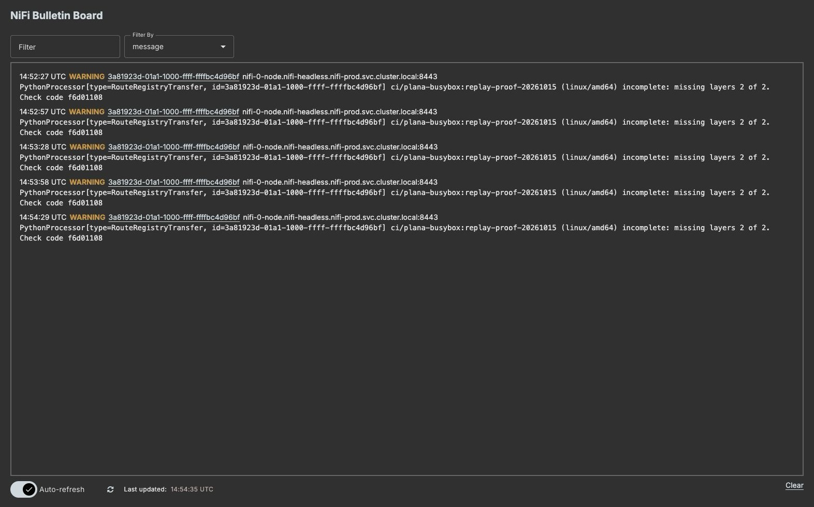
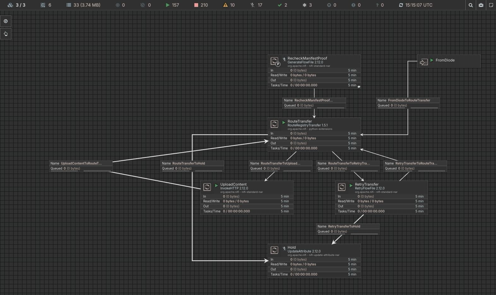

# Image transfer live recovery proof

On 2026-10-15 (Sydney; 2026-10-14 UTC), the production NiFi 2.12.0 flow with PlanRegistryTransfer/RouteRegistryTransfer 1.5.1 recovered a missing layer using both a selective replay and an image/tag-only replay. No processor source code changed. [The by-hand guide](image-transfer-build-by-hand.md#9-recover-a-held-or-incomplete-transfer) documents the operator controls; [the evidence JSON](../reference/image-transfer-recovery-evidence.json) records status, hashes, sizes, timestamps and selected provenance events without credentials or FlowFile attribute dumps.

## Fixture and deletion boundary

The dedicated synthetic image was `ci/plana-busybox:replay-proof-20261015` on low and `research/native-high:replay-proof-20261015` on high. Its immutable OCI manifest is `sha256:f6d01108983017ad2bd69c8521075c232e72aaf375e0064c24f6376b212e58c9`; its check code is `f6d01108`, platform `linux/amd64`.

| Component | Bytes | SHA-256 |
|---|---|---|
| Config | 337 | See the manifest/evidence |
| Layer 1 | 262,407 | `388fe936ed0dc1f4b7e6a260be8e93f584210756afa706445ba93d485fa0165f` |
| Layer 2, deliberately removed | 262,414 | `20245d360908c8180f10e2f2ec4942317496978e3efb100a744e5dea700a5996` |

The initial full transfer completed; high's manifest and downloaded layer bytes were verified. Quay 3.15.7 rejects arbitrary blob DELETE (observed HTTP 405; [its implementation explicitly raises Unsupported](https://github.com/quay/quay/blob/v3.15.7/endpoints/v2/blob.py)). Therefore deletion was a **controlled fixture-only fault injection**, not a supported registry maintenance procedure:

- Checked that the target digest had exactly one storage record and references only from this dedicated proof image.
- Saved reversible repository-reference backups and invalidated only the fixture's blob cache entry.
- Removed the fixture's repository references; HEAD and GET then returned 404 for layer 2 while layer 1 still returned 200.
- For the stronger physical test, also moved the unique layer file out of **active high-side blob storage** into a quarantine backup. The original active path was absent before replay.
- Verified the restored active file came from NiFi's upload and matched the source bytes. The quarantine file was not copied back to restore the active blob.
- Restored the original test manifest's database association after the GET/hash proof as fault cleanup. Quay's PUT of an already-existing manifest does not repair artificially removed database associations; replay restores the upload/blob, not arbitrary registry database corruption.

Other images, shared layers, credentials and existing research fixtures were untouched. Do **not** use database edits or storage deletion as an operator recovery technique. A layer lost in transit normally has never been linked on high; this test deliberately made a previously present fixture unavailable to exercise the same 404/replay path.

## Selective replay

High rechecked the exact fixture manifest and emitted this real warning while retaining it in the penalized retry queue:

> `ci/plana-busybox:replay-proof-20261015 (linux/amd64) incomplete: missing layers 2 of 2. Check code f6d01108`

Recorded example from 2026-10-15, with the account header cropped out.

(A GenerateFlowFile starts with none of the webhook's attributes; the dynamic properties it needs, and nothing else, are listed in [the input contract](../reference/contract.md#standing-in-for-the-webhook-with-generateflowfile).) The low stopped GenerateFlowFile had image reference, `registry.layers=2`, `registry.check=f6d01108`, `registry.platform=linux/amd64`, Primary node execution and batch size 1. Run once created exactly **one request**. Low fetched the 337-byte config and the 262,414-byte missing layer; it did not fetch layer 1 for this replay. High uploaded layer 2, skipped the existing config, and then committed the retained manifest by digest and tag. High HEAD/GET became 200, the downloaded blob hash/size matched, and both work/failure canvases drained.

## Whole-image replay

The test layer was made unavailable again. The same low generator was renamed `ResendImage`; all layer/check/platform fields were removed, leaving only `registry.image.reference=ci/plana-busybox:replay-proof-20261015`. Run once created one request and low fetched the complete image. High skipped existing config/layer 1 and uploaded the missing layer; digest/tag manifest PUTs completed. GET returned the exact 262,414-byte layer again.

## Physical removal and whole-image replay

At **15:09:28 UTC**, the unique layer 2 file was absent from active storage and high HEAD/GET returned 404. At **15:09:30.439 UTC**, one low GenerateFlowFile CREATE event (`12753541`) initiated image/tag-only recovery.

| Native event | UTC time | Event ID | Bytes |
|---|---|---|---|
| Low InvokeHTTP FETCH config | 15:09:30.852 | 12753574 | 337 |
| Low InvokeHTTP FETCH layer 1 | 15:09:30.956 | 12753578 | 262,407 |
| Low InvokeHTTP FETCH layer 2 | 15:09:31.090 | 12753591 | 262,414 |
| High InvokeHTTP SEND missing layer 2 | 15:09:32.643 | 12753707 | 262,414 |
| High InvokeHTTP SEND manifest by digest | 15:10:02.415 | 12759242 | 561 |
| High InvokeHTTP SEND manifest tag | 15:10:02.456 | 12759246 | 561 |

At **15:09:46.885 UTC**, high HEAD/GET already returned 200 and the downloaded layer matched both its expected SHA-256 and size. A direct filesystem check confirmed the active blob file had been recreated with those exact bytes, before cleanup touched the manifest association. After the dependency retry, the new manifest job completed too. Both sides finished with zero queued FlowFiles, including zero failures into Hold.

Recorded example from 2026-10-15: the high side canvas as it was during the proof, before the cards and group were renamed and before the Hold card became a disabled LogMessage. The account header and breadcrumb are cropped out.

The high `RecheckManifestProof` source shown above was used only to place the fixture manifest back through dependency checking. It is disabled and is **not required in the work flow**. The low ResendImage request fields were cleared and that generator disabled after the tests; both Holds stayed disabled throughout. Fixture data and fault backups are retained for review.

## What this proves and what it does not

This proves one manual request on a three-node cluster, correct selective/full planning, real native low downloads and high uploads, high deduplication, missing-layer reporting, exact byte restoration and empty final queues. The physical storage test strengthens the earlier repository-visibility-only checks.

It does not prove automatic repair of arbitrary Quay database/storage corruption, recovery of an old manifest after its source tag moves, or the work site's physical diode integration. Whole-image mode sends all bytes across the diode even when high already has most blobs. The synthetic fixture is a transfer test, not a runnable application image. The real 1 GiB transfer proof is separate; this recovery proof used a small unique blob so no shared production data had to be removed.
