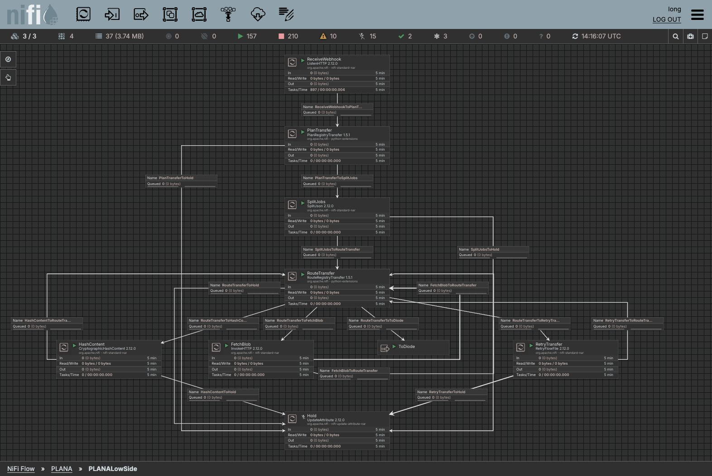
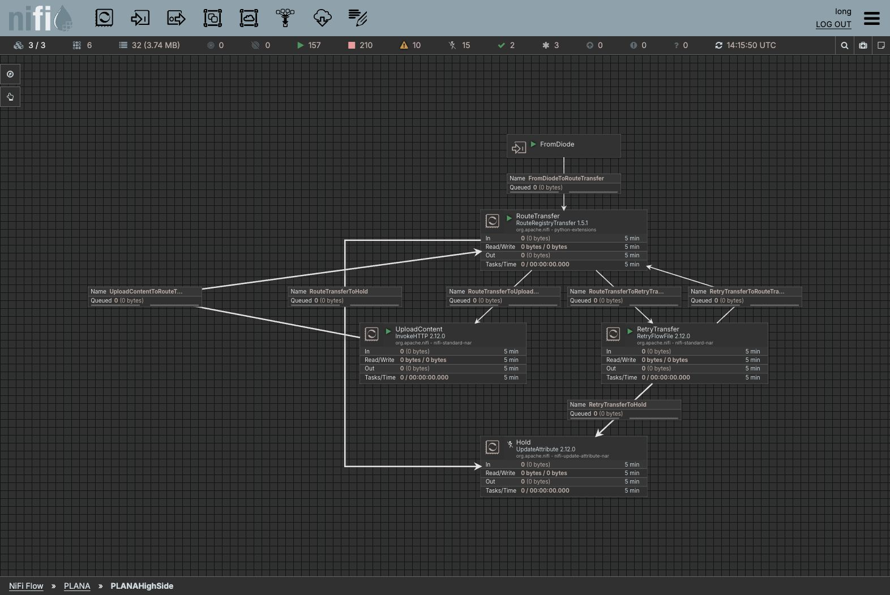
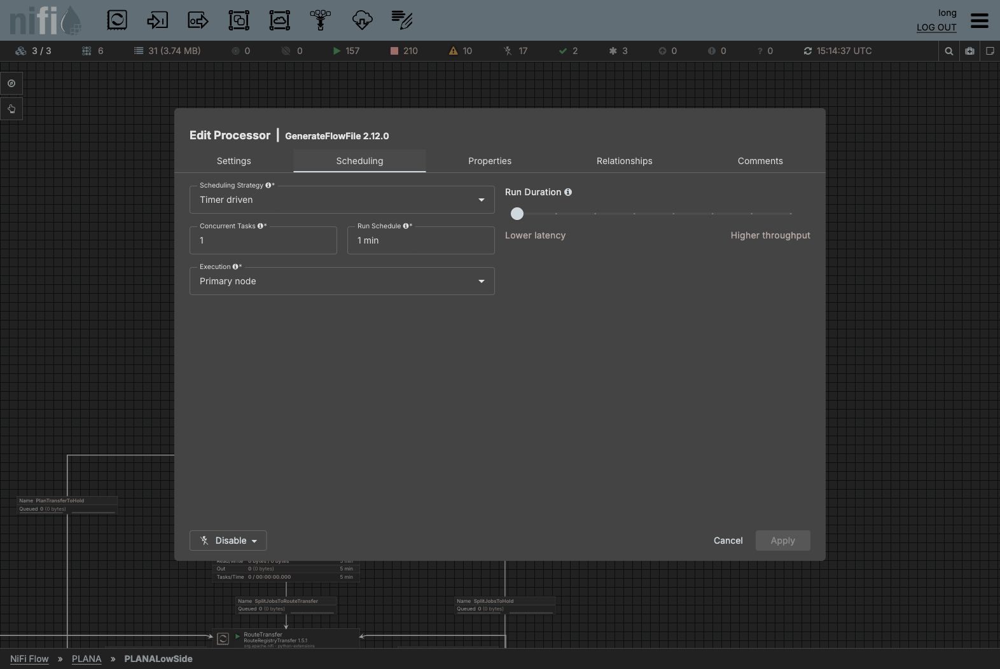
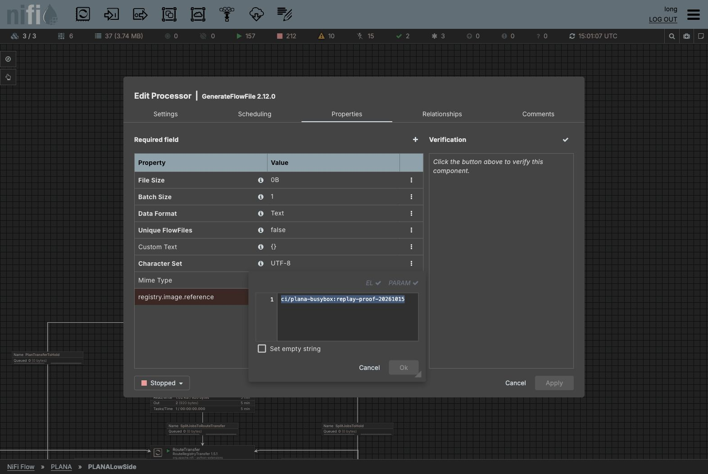
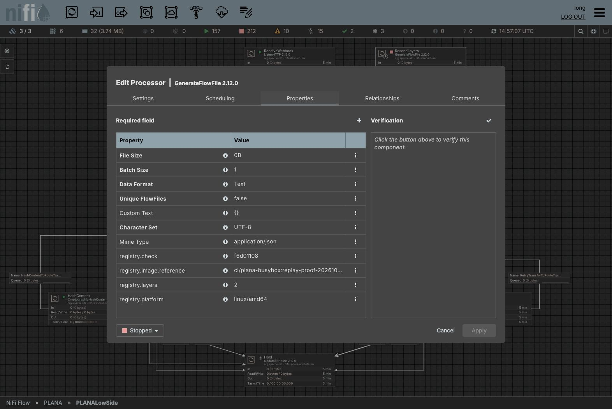
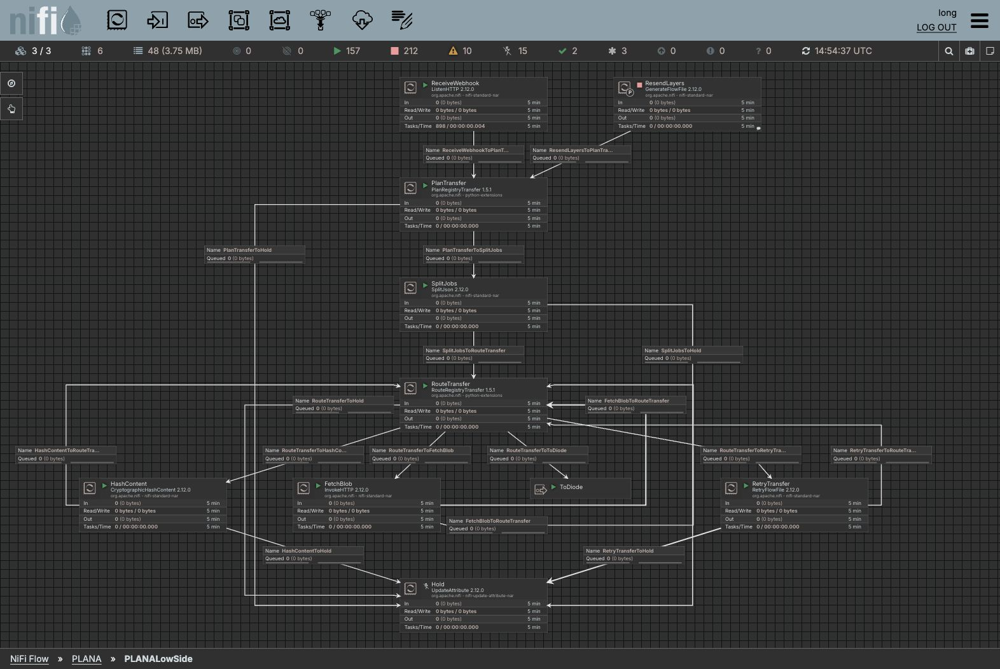

# Build PLANA compact layer transfer by hand

Build this **12-processor flow** from an empty NiFi canvas: eight processors on the low side, four on the high side, and two diode ports. This guide uses **NiFi 2.12.0** and **PlanRegistryTransfer / RouteRegistryTransfer 1.5.1**. Every declared processor property, scheduling setting, relationship and connection is listed below. Values match the tested flow except registry addresses, credentials and CA paths, which are examples.

`#{name}` is a **Parameter Context** reference. `${name}` is **FlowFile Expression Language**. Copy both forms exactly. **Leave blank** means unset the property, not enter the words “Leave blank”. Property names and relationships are case-sensitive; processor display names use PascalCase.

## Live layout screenshots

These are actual screenshots of the running, empty-queue PLANA canvases on 2026-10-15. Click an image to open it at full size. Connection labels show names; use the wiring tables for the selected relationships. Statistics in the top toolbar describe the whole NiFi cluster, not only PLANA.

### Low side

[](../images/plana-low-side.jpg)

### High side

[](../images/plana-high-side.jpg)

## 1. Install the Python processors on every node

You need Python 3.10 or later, NiFi's standard processor NARs, access to each registry's HTTPS endpoint, and enough content/provenance disk for active transfers and retention. Neither Docker nor skopeo is required on the NiFi nodes. Copy the **whole** `python/container_registry` directory, including its helper modules; copying just the two processor files is insufficient.

For the validated source revision:

```sh
git clone https://github.com/djlongy/nifi-container-registry-processors.git
cd nifi-container-registry-processors
git checkout 559c53aa6e7bac04f53c83239dc3b184531caad7
cp -R python/container_registry /opt/nifi/nifi-current/python_extensions/
```

Run the copy as the NiFi service account, or set ownership so that account can read the files and write its Python working/virtual-environment directory. Adjust the destination to `nifi.python.extensions.source.directory.default` in `nifi.properties`. Set `nifi.python.command` to your Python executable if Python is not enabled. Changing NiFi startup properties requires a restart; copying extension files is discovered by the loader. On a cluster install the same files on **every node**, then wait until both processor types at **1.5.1** appear in **Add Processor** and validate across the cluster. Do not change an existing Python processor's bundle version by API; create it at the installed version.

For containers persist the modules through an image/init container or a mounted source directory. A manual copy is lost if your init container replaces that directory at restart. Do not install the older Java/NAR implementation for this flow.

## 2. Create contexts, groups and optional trust services

On one test NiFi instance, drag a **Process Group** onto the root canvas, name it `PLANA`, and create children `PLANALowSide` and `PLANAHighSide`. Build processors inside those children. At work, where the diode separates two NiFi instances, create the low group on the low instance and the high group on the high instance; there is no direct parent connection across the physical boundary.

Open **Global menu → Parameter Contexts → +**. For a same-instance test create `PLANARegistry`, enter the following parameters, then bind it with **PLANA → Configure → Parameter Context**. Children inherit it. For physically separated instances, use a low context containing only `src_*`, `allowed_repositories`, `platforms` and any low trust password; the high context contains only `dst_*` and any high trust password. Do not copy source credentials to the high context.

| Parameter | Sensitive | Example value / purpose |
|---|---|---|
| `src_url` | No | `https://quay-low.example.internal` |
| `src_user` | No | `team+mirror_read` robot with pull access |
| `src_password` | **Yes** | Your source robot token; enter it in the sensitive parameter, never a literal processor property |
| `allowed_repositories` | No | `team/app` (exact allowlist), or `team/*` for a reviewed namespace; comma/newline-separated entries supported |
| `platforms` | No | `all` preserves every platform and original index; example subset `linux/amd64` |
| `dst_url` | No | `https://quay-high.example.internal` |
| `dst_user` | No | `team+mirror_write` robot with pull/push access |
| `dst_password` | **Yes** | Your destination robot token |
| `dst_repository` | No | `team/app-mirror`; blank preserves each source repository instead |
| `truststore_password` | **Yes** | Only when using the optional `RegistryTrust` service |

The registry URL/user/password come from these contexts, **not from webhook-supplied attributes**. Use an existing registry repository with the required robot permissions. If mirroring several source repositories, leave `dst_repository` blank to preserve their paths; a single override can cause equal tags from different sources to overwrite each other.

### Optional private-CA trust

With certificates trusted by the system store, leave **SSL Context Service blank** everywhere. For private CAs create **Controller Services → + → StandardSSLContextService 2.12.0**, name it `RegistryTrust`, and place it at a scope visible to the processors using it. The following table lists all its properties:

| Property | Example value |
|---|---|
| Keystore Filename | **Leave blank** |
| Keystore Password | **Leave blank** |
| Key Password | **Leave blank** |
| Keystore Type | **Leave blank** |
| Truststore Filename | `/opt/nifi/certs/registry-trust.p12` |
| Truststore Password | `#{truststore_password}` |
| Truststore Type | `PKCS12` |
| TLS Protocol | `TLS` |

For example, create a truststore from your registry CA, on each node at the same path:

```sh
keytool -importcert -noprompt -alias registry-ca -file /path/to/registry-ca.pem \
  -keystore /opt/nifi/certs/registry-trust.p12 -storetype PKCS12
```

Let keytool prompt for the truststore password, then use that password in the sensitive context parameter. Import any additional CA/intermediate needed, using a distinct alias. Enable `RegistryTrust` before selecting it in processors. Python adds its CA certificates to the system trust store. Native **InvokeHTTP replaces its trust configuration when you select an SSL service**: that truststore must contain every CA needed for the registry chain; include public roots too when talking to both public- and private-CA endpoints. Do not disable TLS verification. Registry mTLS/client certificates and Basic-only registries are outside this tested compact flow.

## 3. Create and schedule the cards

Use **Add Processor**, search for the type, select the exact version, then **Configure → Settings → Name**. Add the low output port `ToDiode` and high input port `FromDiode` with the respective toolbar controls. All ports start when the rest of the flow starts. No funnels, settings-only processors or tar directory are needed.

| Group | Display name | Type | Version | Initial state |
|---|---|---|---|---|
| Low | ReceiveWebhook | ListenHTTP | 2.12.0 | Stopped while configuring |
| Low | PlanTransfer | PlanRegistryTransfer | 1.5.1 | Stopped while configuring |
| Low | SplitJobs | SplitJson | 2.12.0 | Stopped while configuring |
| Low | RouteTransfer | RouteRegistryTransfer | 1.5.1 | Stopped while configuring |
| Low | FetchBlob | InvokeHTTP | 2.12.0 | Stopped while configuring |
| Low | HashContent | CryptographicHashContent | 2.12.0 | Stopped while configuring |
| Low | RetryTransfer | RetryFlowFile | 2.12.0 | Stopped while configuring |
| Low | Hold | UpdateAttribute | 2.12.0 | **Disabled** |
| High | RouteTransfer | RouteRegistryTransfer | 1.5.1 | Stopped while configuring |
| High | UploadContent | InvokeHTTP | 2.12.0 | Stopped while configuring |
| High | RetryTransfer | RetryFlowFile | 2.12.0 | Stopped while configuring |
| High | Hold | UpdateAttribute | 2.12.0 | **Disabled** |

Set these common settings on every processor (including the disabled Holds):

| Tab / setting | Recommended value |
|---|---|
| Scheduling → Strategy | Timer driven |
| Scheduling → Run schedule | `0 sec` |
| Scheduling → Execution | All nodes |
| Scheduling → Concurrent tasks | `1` to start; measure disk/network throughput before increasing |
| Scheduling → Run duration | `0 ms` for standard processors except UpdateAttribute; `25 ms` for both Python types and UpdateAttribute |
| Settings → Penalty duration | `30 sec` |
| Settings → Yield duration | `1 sec` |
| Settings → Bulletin level | `WARN` |
| Settings → Comments | Blank |
| Settings → Automatically retry relationships | **None selected**; use RetryTransfer connections below |
| Automatic retry count / backoff / maximum | Leave defaults `10`, Penalize FlowFile, `10 mins`; inactive with no retry relationships selected |
| Loss tolerant (if your API exposes it) | `false` |

**Hold is a parking destination, not a processor you run.** After configuring it, right-click → **Disable** on each Hold. Its `success` relationship is auto-terminated solely to keep its configuration valid. **Starting Hold would consume and discard held failures.** Use the recovery procedure before changing its state.

## 4. Enter every processor property

Open **Configure → Properties** for each card. Values below include native defaults, so a fresh 2.12.0 installation can be checked line by line. Properties such as Request Header Attributes Pattern must remain blank: forwarding every incoming attribute could expose tokens or add invalid HTTP headers. Only the explicit dynamic `Authorization` property is used.

### Low ReceiveWebhook — ListenHTTP

| Property | Recommended/example value |
|---|---|
| Base Path | `plana-webhook` |
| Listening Port | `9617` |
| Listening Port for Health Check Requests | **Leave blank** |
| SSL Context Service | **Leave blank** |
| HTTP Protocols | `HTTP_1_1` |
| Client Authentication | `AUTO` |
| Authorized Subject DN Pattern | `.*` |
| Authorized Issuer DN Pattern | `.*` |
| Max Unconfirmed Flowfile Time | `60 secs` |
| HTTP Headers for Attributes | `(?i)(X-.*\|Filename\|Content-Type)` |
| Request Header Maximum Size | `8 KB` |
| Return Code | `202` |
| Multipart Request Max Size | `1 MB` |
| Multipart Read Buffer Size | `512 KB` |
| Maximum Thread Pool Size | `16` |
| Record Reader | **Leave blank** |
| Record Writer | **Leave blank** |

ListenHTTP listens on plain HTTP internally in this example; terminate HTTPS at a trusted ingress/reverse proxy and restrict the sender. **Client Authentication / subject / issuer patterns do not authenticate plain-HTTP requests.** The JSON webhook is metadata, not image bytes. The `Multipart Request Max Size` property controls multipart requests, not arbitrary JSON; enforce a JSON request-body cap at the ingress (example `1m`). Its only relationship is `success`.

### Low PlanTransfer — PlanRegistryTransfer

| Property | Recommended/example value |
|---|---|
| Source Registry URL | `#{src_url}` |
| Source Registry Username | `#{src_user}` |
| Source Registry Password | `#{src_password}` |
| SSL Context Service | `RegistryTrust (private CA only; otherwise blank)` |
| Allowed Repositories | `#{allowed_repositories}` |
| Platform Selection | `#{platforms}` |
| Maximum Manifest Depth | `16` |
| Maximum Jobs Per Transfer | `1000` |
| Request Timeout | `120` |

Use `RegistryTrust` only when needed as described above. `Request Timeout` is an integer number of **seconds**, not a NiFi duration string. Set the source password property to its sensitive parameter reference. PlanTransfer validates the checksum, registry, image syntax and allowlist, resolves immutable manifests and emits upfront job facts. Set auto-termination to `original` only; connect `success` and `failure` below.

### Low SplitJobs — SplitJson

| Property | Recommended/example value |
|---|---|
| JsonPath Expression | `$.jobs` |
| Null Value Representation | `empty string` |
| Max String Length | `20 MB` |

Auto-terminate `original`; connect `split` and `failure`. This splits the small job JSON, never a downloaded blob.

### Low and high RouteTransfer — RouteRegistryTransfer

| Property | Low value | High value |
|---|---|---|
| Transfer Side | `Low` | `High` |
| Registry URL | `#{src_url}` | `#{dst_url}` |
| Registry Username | `#{src_user}` | `#{dst_user}` |
| Registry Password | `#{src_password}` | `#{dst_password}` |
| SSL Context Service | Blank for system trust, otherwise `RegistryTrust` | Blank for system trust, otherwise high-side `RegistryTrust` |
| Target Repository | **Leave blank** | `#{dst_repository}` (or blank to keep source repository) |
| Request Timeout | `60` seconds | `60` seconds |

Low auto-termination: `original` only. High auto-termination: `original`, `ready`. Connect every other relationship as listed below; high `hash` is intentionally sent to Hold because the high controller never asks to hash content.

RouteTransfer handles scoped registry authentication, metadata HEAD requests and empty upload-start POSTs. Native InvokeHTTP carries the blob bytes. The low FetchBlob callback returns to RouteTransfer **before HashContent** so the source Authorization value is cleared before the diode. This clears the current attribute value; it cannot erase earlier provenance records. The high controller checks dependencies before manifest PUT, commits by digest first and then by tag.

### Low FetchBlob and high UploadContent — InvokeHTTP

Enter all fixed properties below. Add `Authorization` with **Properties → +** as a **dynamic HTTP-header property**; it is not Request Username/Password and it is not NiFi's Request OAuth2 Access Token Provider.

| Property | Low FetchBlob | High UploadContent |
|---|---|---|
| HTTP Method | `${registry.http.method}` | `${registry.http.method}` |
| HTTP URL | `${registry.http.url}` | `${registry.http.url}` |
| HTTP/2 Disabled | `False` | `False` |
| SSL Context Service | **Leave blank** | **Leave blank** |
| Connection Timeout | `30 secs` | `30 secs` |
| Socket Read Timeout | `10 mins` | `10 mins` |
| Socket Write Timeout | `10 mins` | `10 mins` |
| Socket Idle Timeout | `5 mins` | `5 mins` |
| Socket Idle Connections | `5` | `5` |
| Proxy Configuration Service | **Leave blank** | **Leave blank** |
| Request OAuth2 Access Token Provider | **Leave blank** | **Leave blank** |
| OAuth2 Access Token Refresh Strategy | `ON_TOKEN_EXPIRATION` | `ON_TOKEN_EXPIRATION` |
| Request Username | **Leave blank** | **Leave blank** |
| Request Password | **Leave blank** | **Leave blank** |
| Request Digest Authentication Enabled | `false` | `false` |
| Request Failure Penalization Enabled | `false` | `false` |
| Request Body Enabled | `false` | `true` |
| Request Multipart Form-Data Name | **Leave blank** | **Leave blank** |
| Request Multipart Form-Data Filename Enabled | `true` | `true` |
| Request Chunked Transfer-Encoding Enabled | `false` | `false` |
| Request Content-Encoding | `DISABLED` | `DISABLED` |
| Request Content-Type | `${registry.http.media.type}` | `${registry.http.media.type}` |
| Request Date Header Enabled | `True` | `True` |
| Request Header Attributes Pattern | **Leave blank** | **Leave blank** |
| Request User-Agent | **Leave blank** | **Leave blank** |
| Response Body Attribute Name | **Leave blank** | **Leave blank** |
| Response Body Attribute Size | `256` | `256` |
| Response Body Ignored | `false` | `true` |
| Response Cache Enabled | `false` | `false` |
| Response Cache Size | `10MB` | `10MB` |
| Response Cookie Strategy | `DISABLED` | `DISABLED` |
| Response Generation Required | `false` | `false` |
| Response FlowFile Naming Strategy | `RANDOM` | `RANDOM` |
| Response Header Request Attributes Enabled | `true` | `true` |
| Response Header Request Attributes Prefix | `resp.` | `resp.` |
| Response Redirects Enabled | `False` | `False` |
| Authorization | `${registry.auth.header}` | `${registry.auth.header}` |

For private CAs, replace the blank native SSL service with the correctly populated `RegistryTrust`. Leave Request Username/Password and the OAuth2 provider blank; the controller supplies scoped Bearer authentication. Leave redirects disabled to prevent payload credentials being sent to an unexpected host. Response Body Attribute Name stays blank so image bytes are never copied into an attribute.

FetchBlob auto-terminates `Original` and returns `Response` to the controller as a separate connection. Its failure/retry relationships also return to the controller. UploadContent auto-terminates `Response`; `Original`, `Retry`, `No Retry`, `Failure` return on one connection. Capitalization is deliberate: InvokeHTTP uses capitalized relationships; the Python and RetryFlowFile relationships use lower case.

### Low HashContent — CryptographicHashContent

| Property | Recommended/example value |
|---|---|
| Fail When Content Empty | `false` |
| Hash Algorithm | `SHA-256` |

HashContent writes `content_SHA-256`; RouteTransfer compares it and the FlowFile size with the planned digest/size before release. Connect `success` back to RouteTransfer and `failure` to Hold; auto-terminate neither.

### Both RetryTransfer cards — RetryFlowFile

| Property | Recommended/example value |
|---|---|
| Retry Attribute | `registry.retries` |
| Maximum Retries | `${registry.retry.max}` |
| Penalize Retries | `true` |
| Fail on Nonnumerical Overwrite | `false` |
| Reuse Mode | `fail` |

Set the same properties on the high card. RouteTransfer sets `registry.retry.max` to `3` for transient HTTP errors or `120` for missing manifest dependencies. With `30 sec` penalties, 120 retries is roughly an hour plus work/queue delay; it is not an exact wall-clock timeout. Retries return to RouteTransfer for fresh metadata/authentication; exhausted or malformed retries go to Hold. Auto-terminate nothing.

### Both Hold cards — UpdateAttribute

| Property | Recommended/example value |
|---|---|
| Delete Attributes Expression | **Leave blank** |
| Store State | `Do not store state` |
| Stateful Variables Initial Value | **Leave blank** |
| Cache Value Lookup Cache Size | `100` |

Do not add dynamic attributes. Auto-terminate `success`, then **Disable** the processor and leave it disabled. This retains original FlowFiles in its incoming queues, including the `registry.error` explanation.

## 5. Create every connection and auto-termination

Drag from a source card's connection handle to its destination, choose the exact relationships in **Details**, and set the queue settings below. A row containing several relationships means **one connection** with all of them selected. Rows with the same source/destination but different relationship sets are **separate connections**.

Apply these properties to **all** low/high connections and the optional test bridge:

| Connection setting | Value |
|---|---|
| Back pressure object threshold | `20` |
| Back pressure data size threshold | `20 GB` |
| FlowFile expiration | `0 sec` (never expire retained failures) |
| Prioritizers | None |
| Load balance strategy | Do not load balance |
| Load balance compression | Do not compress / inactive |

`20 GB` is a tested example, not a disk reservation. Choose a size larger than your largest individual blob, and size the content repository for concurrent claims, retries and archival retention across **all** queues. The live test used 40 GiB content volumes on each node. More queues do not create more disk. Leave object threshold 20 initially to bound the work backlog. Port connections use no named relationship.

### Low-side wiring — 16 connections

| # | Source | Selected relationships | Destination | Connection name |
|---|---|---|---|---|
| L1 | ReceiveWebhook | `success` | PlanTransfer | `ReceiveWebhookToPlanTransfer` |
| L2 | PlanTransfer | `success` | SplitJobs | `PlanTransferToSplitJobs` |
| L3 | PlanTransfer | `failure` | Hold | `PlanTransferToHold` |
| L4 | SplitJobs | `split` | RouteTransfer | `SplitJobsToRouteTransfer` |
| L5 | SplitJobs | `failure` | Hold | `SplitJobsToHold` |
| L6 | RouteTransfer | `http` | FetchBlob | `RouteTransferToFetchBlob` |
| L7 | RouteTransfer | `hash` | HashContent | `RouteTransferToHashContent` |
| L8 | RouteTransfer | `ready` | ToDiode | `RouteTransferToToDiode` |
| L9 | RouteTransfer | `retry` | RetryTransfer | `RouteTransferToRetryTransfer` |
| L10 | RouteTransfer | `failure` | Hold | `RouteTransferToHold` |
| L11 | FetchBlob | `Response` | RouteTransfer | `FetchBlobToRouteTransfer` |
| L12 | FetchBlob | `Failure`, `No Retry`, `Retry` | RouteTransfer | `FetchBlobToRouteTransfer` |
| L13 | HashContent | `success` | RouteTransfer | `HashContentToRouteTransfer` |
| L14 | HashContent | `failure` | Hold | `HashContentToHold` |
| L15 | RetryTransfer | `retry` | RouteTransfer | `RetryTransferToRouteTransfer` |
| L16 | RetryTransfer | `retries_exceeded`, `failure` | Hold | `RetryTransferToHold` |

### High-side wiring — 7 connections

| # | Source | Selected relationships | Destination | Connection name |
|---|---|---|---|---|
| H1 | FromDiode | None (port) | RouteTransfer | `FromDiodeToRouteTransfer` |
| H2 | RouteTransfer | `http` | UploadContent | `RouteTransferToUploadContent` |
| H3 | RouteTransfer | `retry` | RetryTransfer | `RouteTransferToRetryTransfer` |
| H4 | RouteTransfer | `failure`, `hash` | Hold | `RouteTransferToHold` |
| H5 | UploadContent | `Original`, `No Retry`, `Retry`, `Failure` | RouteTransfer | `UploadContentToRouteTransfer` |
| H6 | RetryTransfer | `retry` | RouteTransfer | `RetryTransferToRouteTransfer` |
| H7 | RetryTransfer | `retries_exceeded`, `failure` | Hold | `RetryTransferToHold` |

### Complete auto-termination checklist

| Group | Processor | Auto-terminate these only |
|---|---|---|
| Low | ReceiveWebhook | None |
| Low | PlanTransfer | `original` |
| Low | SplitJobs | `original` |
| Low | RouteTransfer | `original` |
| Low | FetchBlob | `Original` |
| Low | HashContent | None |
| Low | RetryTransfer | None |
| Low | Hold | `success` (processor remains disabled) |
| High | RouteTransfer | `original`, `ready` |
| High | UploadContent | `Response` |
| High | RetryTransfer | None |
| High | Hold | `success` (processor remains disabled) |

In the processor relationship settings, leave every other relationship connected; do not also select automatic relationship retries. No disconnected relationship may remain unterminated.

### Across the diode

For a same-cluster test only, return to the parent `PLANA` canvas and connect the `ToDiode` port on the low group to `FromDiode` on the high group. Name it `DiodeStandIn`, use the common queue settings, and select no relationship. This is a test stand-in, **not a physical data diode**.

At work replace the bridge with the diode integration: low `ToDiode` → your sender; your receiver → high `FromDiode`. Preserve each FlowFile's **exact bytes and attributes**, including `registry.kind`, `repository`, `digest`, `size`, `media.type`, `reference`, `needs`, `image`, `platform`, `check`, `layer.count` (all with the `registry.` prefix). Do not strip `content_SHA-256` or other job facts. Source `registry.auth.header` must be empty before crossing. Do not serialize credentials/parameter contexts with the jobs. An out-of-order diode is supported: high manifests wait for their dependencies. The estate-specific sender/receiver configuration is supplied by your diode operator and is not implemented by these two ports.

## 6. Copy the layout

Place the main route vertically. On low, the webhook/planner/split/controller form the central column; hash and HTTP are left of the controller, the diode port and retry card right, Hold below. On high, FromDiode/controller/Hold form the central column with upload left and retries right. Put long return connections in separate outer lanes; keep labels clear of cards and other labels.

These are actual card positions from the screenshots. They are top-left canvas coordinates, not screen pixels. Drag approximately to reproduce them; optional MCP imports can set coordinates. Port widths differ from processor widths, so ports use a small horizontal centering offset.

| Group | Card | X | Y |
|---|---|---|---|
| Low | ReceiveWebhook | 0 | 0 |
| Low | PlanTransfer | 0 | 240 |
| Low | SplitJobs | 0 | 480 |
| Low | RouteTransfer | 0 | 720 |
| Low | HashContent | -768 | 960 |
| Low | FetchBlob | -256 | 960 |
| Low | ToDiode | 312 | 960 |
| Low | RetryTransfer | 768 | 960 |
| Low | Hold | 0 | 1200 |
| High | FromDiode | 56 | 0 |
| High | RouteTransfer | 0 | 160 |
| High | UploadContent | -256 | 400 |
| High | RetryTransfer | 256 | 400 |
| High | Hold | 0 | 640 |

Select a connection to expose its handles, drag bend handles into free lanes, and drag its label away from overlaps. The two FetchBlob→RouteTransfer connections must have separate paths/labels. Arrow direction and the wiring tables determine behaviour; bends only affect readability. The [low](../flows/compact-layer-low-mcp-spec.json) and [high](../flows/compact-layer-high-mcp-spec.json) JSON files are **NiFi MCP flow specs**, not native NiFi UI import files. They omit credentials and optional trust services; bind your contexts, set trust if needed, and disable Hold before starting an imported flow. Automatic layout can replace manual bends.

## 7. Publish the webhook endpoint and connect GitLab

The low listener URL inside the network is `http://<low-nifi-host>:9617/plana-webhook`. In a cluster, expose a service targeting the ready low NiFi nodes. Publish an HTTPS ingress/reverse-proxy URL such as `https://nifi-low.example.internal/plana-webhook`, route that **exact path** to backend port 9617 over HTTP, set a 1 MB JSON body cap and allow only your GitLab mirror runner/source IP (example `192.0.2.41/32`). Use a certificate your runner trusts. Do not route it to the NiFi UI's 8443 port. The listener reserves port 9617 on every node, so another listener cannot use the same port.

Configure the existing **gitlab-registry-mirror** project (not a standard GitLab project-event webhook; its payload differs):

| CI/CD variable | Example value |
|---|---|
| TARGET_REGISTRY | `quay-low.example.internal` (host, without `https://`) |
| TARGET_REGISTRY_USERNAME | `team+mirror_write` with write access to the low repository |
| TARGET_REGISTRY_PASSWORD | Sensitive low mirror robot token; masked/protected CI variable |
| MIRROR_WEBHOOK_URL | `https://nifi-low.example.internal/plana-webhook` |
| MIRROR_PLATFORM | `linux/amd64` for a small first test; choose all platforms in the mirror when testing a full index |
| MIRROR_WEBHOOK_CA_BUNDLE | Optional runner-local PEM CA bundle for a private-CA ingress |

Use the variable environment scope matching your mirror job (the tested job used `mirror-low`). Keep registry credentials in protected CI/Vault settings. Add a reviewed, pinned small image to `images.txt`, run the pipeline and check its sync job. The mirror posts only when it **copies a changed tag**; retrying an already-synced pipeline normally sends no new webhook. Use a new tag or the explicit manual request below. An HTTP 202 means the listener accepted the request, not that transfer succeeded. This minimal ListenHTTP flow does not validate MIRROR_WEBHOOK_TOKEN; use your ingress to enforce authentication if required, and do not log credential headers.

### Manual first request

Run this request on the sender/runner allowed by your ingress. Put a real small image in the low registry first and obtain its **actual** manifest digest using your registry UI or authenticated tooling. Use the original OCI/Docker media type: asking Quay for only Docker-v2 can convert an OCI manifest and change its hash. Replace all example values below; the digest cannot be guessed or filled with zeros.

```sh
export PLANA_SOURCE_HOST='quay-low.example.internal'
export PLANA_SOURCE_REPOSITORY='team/app'
export PLANA_SOURCE_TAG='1.0'
export PLANA_SOURCE_DIGEST='sha256:<actual-64-hex-manifest-digest>'
export PLANA_WEBHOOK_URL='https://nifi-low.example.internal/plana-webhook'
python3 - <<'PYREQUEST'
import hashlib, json, os, urllib.request
body = json.dumps({"registry": os.environ["PLANA_SOURCE_HOST"], "images": [{
    "repository": os.environ["PLANA_SOURCE_REPOSITORY"],
    "tag": os.environ["PLANA_SOURCE_TAG"],
    "digest": os.environ["PLANA_SOURCE_DIGEST"]}]}).encode()
request = urllib.request.Request(os.environ["PLANA_WEBHOOK_URL"], data=body, method="POST", headers={
    "Content-Type": "application/json", "X-Artifact-Type": "container-images-request",
    "X-Sha256": hashlib.sha256(body).hexdigest()})
with urllib.request.urlopen(request, timeout=30) as response:
    print("Webhook status:", response.status)
PYREQUEST
```

Expected response: 202. Python uses your system HTTPS trust; for a private-CA ingress configure the sender's CA trust before running. The request contains registry/image facts and a checksum, **no registry credentials**. HTTP headers are case-insensitive on the wire; the captured checksum attribute used by PlanTransfer is `X-Sha256`. If your ingress normalizes attribute spelling, inspect the captured attributes and map the checksum to that exact name before planning.

## 8. Start and verify

Start the high processing cards and FromDiode first, then the low cards and ToDiode; keep both Holds **disabled**. Check that all active processors validate on every node. In a same-instance test, confirm the parent bridge exists. Submit the small request, then inspect these signals:

| Signal | Expected result |
|---|---|
| Listener / sync job | HTTP `202` |
| PlanTransfer | One job list, then SplitJobs emits individual blob/config/manifest/index jobs |
| FetchBlob / HashContent | Native streamed content, matching digest and planned size |
| High RouteTransfer | Missing-layer bulletins may appear until dependencies arrive; retries are penalized |
| Destination tag | Present with the exact original manifest digest for your selected platform(s) |
| Destination blobs | Every config/layer digest exists with its planned size |
| Queues into Hold | Empty after success; any retained failure has `registry.error` |
| Low/high work queues | Drain to zero |

The live tests passed BusyBox 1.36.1 and a synthetic image with a 1,048,895,048-byte layer after the persisted extension deployment. The larger OCI manifest was `sha256:e772bf3d7e6cf1c10519f432e8ca25c4e4cdf5e830e3df198e575521543d75a7`; the destination manifest bytes and all blob sizes matched, with empty queues. The 9 GiB source seed failed at low Quay before NiFi received a webhook, so it is **not** a validated 9 GiB transfer. Your work diode integration still needs its own end-to-end test.

## 9. Recover a held or incomplete transfer

Keep failed bytes in place while you read the bulletin and `registry.error`. Do not start Hold, empty its queues, or auto-terminate an additional error relationship to make the canvas green.

| Symptom | Check / action |
|---|---|
| Port 9617 cannot bind | Stop the duplicate listener or choose another free port and update the service/ingress target |
| Invalid sensitive parameter | Password parameter must be marked sensitive and bound to the relevant group |
| PKIX / certificate failure | Configure CA trust separately for Python and native InvokeHTTP; a selected Java truststore replaces native defaults |
| 401/403 | Check robot repository permissions/token; network retries do not repair missing permissions |
| Checksum/registry/allowlist failure | Fix the request or context and send a corrected request; inspect the retained original |
| Hash or size mismatch | Hold the bytes; resend from the trusted source rather than accepting the mismatch |
| Foreign upload URL / Basic-only auth | Refused by this compact controller; use a compatible registry or a separately reviewed transfer option |
| Missing layers on high | Read the human image/platform/layer numbers/check code; resend those layers below |
| Exhausted network retries | Fix registry/network trouble, then submit the same trusted request again; blobs already present on high are deduplicated |
| Stalled large blob | Check content disk, queue byte threshold, ingress/registry timeouts and active InvokeHTTP tasks before raising concurrency |

### Recommended: resend the whole image by tag

If you do not want to work with layer numbers, **resend the entire image**. Low sends its config, layers and manifest/index; high skips blobs already present and uploads the missing ones. This uses more diode bandwidth than selective recovery, but the operator enters only the repository and tag. It also sends a fresh manifest, so it works when the earlier high manifest already exhausted its retries into Hold. Keep the old held failure until you have verified the replacement; do not start Hold to discard it.

Create one optional **GenerateFlowFile 2.12.0** on low, name it `ResendImage`, and connect `success` directly to `PlanTransfer`. Name that connection `ResendImageToPlanTransfer`, select `success` only, and use the common queue settings (`20` objects, `20 GB`, `0 sec` expiration, no prioritizer/load balancing). Auto-terminate nothing on the generator. This adds one manual recovery card to the eight-card low flow; you can keep it disabled when idle. No extra UpdateAttribute processor is needed.

Set every fixed property as follows:

| Property | Value |
|---|---|
| File Size | `0B` (ignored with Custom Text) |
| Batch Size | `1` |
| Data Format | `Text` |
| Unique FlowFiles | `false` |
| Custom Text | `{}` |
| Character Set | `UTF-8` |
| Mime Type | `application/json` |

Use the common scheduling/penalty settings **except**:

| Scheduling setting | Value |
|---|---|
| Execution | **Primary node**, including on a cluster |
| Concurrent tasks | `1` |
| Run schedule | `1 min` (use Run once, never Start) |
| Run duration | `0 ms` |

On a cluster, All nodes can generate one request on **each** node. Primary node plus batch size 1 was verified to generate exactly one request per Run once. On a standalone NiFi the primary-node setting is also appropriate.

[](../images/plana-replay-primary-node.jpg)

Add **one dynamic property** with Properties → +:

| Dynamic property | Example value |
|---|---|
| registry.image.reference | `team/app:1.0` |

The reference is relative to the configured source registry: enter `repository:tag`, without a registry host or URL. Remove any previous `registry.layers`, `registry.check` and `registry.platform` dynamic properties for whole-image mode. The planner uses its configured Platform Selection (`all` in this guide).

[](../images/plana-resend-image-settings.jpg)

1. Keep normal low/high processing running; leave both Holds disabled.
2. If ResendImage is disabled, right-click → **Enable** so it is stopped. Configure and apply the image reference above.
3. Right-click ResendImage → **Run Once**. Do not click Start.
4. Check high's tag/digest/blob sizes and that failure/work queues drain. The generator should show one new request, not one per node.
5. After the request has been emitted, remove `registry.image.reference` and any selective fields, then **Disable ResendImage** again. Leave the normal webhook flow running.

A stopped generator does not run merely because you edit it. Run Once creates the request; PlanTransfer needs that incoming FlowFile. Starting the generator after clearing its reference would produce invalid requests repeatedly. Disable it while idle so starting the whole group cannot trigger accidental resends.

Whole-image `repository:tag` resolves the tag's **current** digest. If the tag moved, you get its current image, which may not repair an older held manifest. Prefer immutable/version tags; use the selective check-code mode below when you need to reject a changed tag. The manual reference bypasses webhook JSON/checksum parsing, but registry/allowlist validation still applies; restrict who can configure/run the generator.

### Optional: resend named layers only

For bandwidth-sensitive recovery, read the high bulletin's image, platform, layer numbers and eight-character check code. On the same **stopped** ResendImage generator add these dynamic properties:

| Dynamic property | Example value |
|---|---|
| registry.image.reference | `team/app:1.0` |
| registry.layers | `2,3` |
| registry.check | `a1b2c3d4` (exact bulletin code) |
| registry.platform | `linux/amd64` (exact bulletin platform; optional for a single-platform image) |

Use Enable → configure/apply → Run Once → clear the four fields → Disable, with Primary node and batch size 1. The planner refuses a stale check code if the tag moved. Selective replay sends the **small config plus the selected layers**, not a manifest and not the other layers. The existing high manifest must still be retained in its retry/hold queue. If that manifest already exhausted retries into Hold, resending layers alone will not automatically commit it: explicitly requeue that manifest with its retry counter reset, or use whole-image mode instead.

[](../images/plana-replay-layer-settings.jpg)

The low canvas with the optional recovery source looks like this (the screenshot was captured during selective setup, before the card was renamed ResendImage):

[](../images/plana-replay-low-side.jpg)

Both modes were verified on the live Quay/NiFi pair, including a whole-image Run once after the unique layer file was removed from active high-side storage. The file was recreated by NiFi and matched the exact SHA-256 and size. See [the reproducible evidence and proof boundary](plana-recovery-proof.md). No scheduled resend is supplied; recovery is operator-triggered.
